[TOC]

## Binary Search

    **Target**  – what to search for.

    **Seach space** – where to search

**Common psedocode:**

* Divide search space into 2 parts
* Based on some condition, repeatedly ignore<mark> one half of the search space</mark>.
* Till we get answer or no search space is left

·       :bulb: **NOTE**  <mark>At each step, search space is halved</mark> 

### Sample questions on Binary search

#### Find first occurrence of an element in given list

**Psedocode**

```java
int searchRange(int a[], int N, int B) {
    int l=0, r=N-1;
    int ans;
    while(l <= r) {
        mid = l+r / 2;
        if(a[mid] == k) {
            ans = mid;
            r = mid-1; // Need to find first occurrence. Though match is found go till end
        } else if (a[i] < B) {
            l = mid+1;
        } else if(a[i] > B) {
            r = mid-1;
        }
    }
    return ans;
}
```

TC - $O(Log n)$

SC - $O(1)$

1. **Find last occurrence of an element in given list**
   
   > ****:bulb: If `a[mid] == k` make `l=mid+1` to move to the right side to find the last occurrence

2. ** Search for a Range of the given element in Sorted array**
   
   * ****Find the **left most and right most occurrence individually**, as per the previous two problems

3. **Find frequency of an element in sorted array –**
   
   ****:bulb:    `frequency = last occurrence – first occurrence +1`

#### Find local minima in a given sorted array

**Minima** - both adjacent elements are large. **Maxima** - both adjacent elements are small

```java
while(l <= r) {
    mid = l+r/2;
    if((mid==0 || A[mid] < A[mid-1]) && (mid == N-1 || A[mid] < A[mid+1])) {
        return A[mid];
    } else if (mid!=0 && A[mid] < A[mid-1]) {
        l = mid + 1;
    } else if(mid != N-1 && A[mid] < A[mid+1]) {  
        r = mid-1;
    }
}
```

#### Find integer part of square root of N

```java
int ans = 0;
int left = 1;
int right = A;
while(l <= r) {
    mid = l + (r-l)/2;
    if(mid * mid == A) {
        return mid;
    } else if (mid * mid > A) {
        r = mid-1;
    } else { 
        ans = mid; 
        l = mid + 1;
    }
}
return ans;
```

6. Given a **sorted array** of integers A (**0-indexed**) of size N, find the **left most** and the **right most** index of a given integer **B** in the array A.

> Find left most index separately.
> 
> Find right most index separately.

### Lab questions - Binary Search

- 2-3 parameters are given and some constraints

- Maximise /Minimize on some parameters

- For ex -
  
  - Minimize max time to paint boards
  
  - Maximize minimum distance between cows

#### Painter's Partition Problem

https://www.scaler.com/academy/mentee-dashboard/class/460278/assignment/problems/271?navref=cl_tt_lst_nmGiven 2 integers **A** and **B** and an array of integers **C** of size **N**. Element **C[i]** represents the length of **ith** board.  
You have to paint all **N** boards **[C0, C1, C2, C3 … CN-1]**. There are **A** painters available and each of them takes **B** units of time to paint **1 unit** of the board.

Calculate and return the<mark> minimum time required to paint all boards</mark> under the constraints that **any painter will only paint contiguous sections of the board.**

**NOTE:**  
**1.** 2 painters cannot share a board to paint. That is to say, a board cannot be painted partially by one painter, and partially by another.  
**2.** A painter will only paint contiguous boards. This means a configuration where painter 1 paints boards 1 and 3 but not 2 is invalid.

**Problem Constraints**  

1 <= A <= 1000  
1 <= B <= 106  
1 <= N <= 105  
1 <= C[i] <= 106

**Example Input**  

Input 1:

 A = 2
 B = 5
 C = [1, 10]

Input 2:

 A = 10
 B = 1
 C = [1, 8, 11, 3]

**Example Output**  

Output 1:

 50

Output 2:

 11

**Target:**    Minimum time to complete the job

**Notes:**

Left => Minimum time to paint. Consider N painters are given.
Right => Max time to paint all boards. Consider only one painter is given

```java
    public int paint(int A, int B, ArrayList<Integer> C) {
        long left = C.get(0);
        long right = 0;
        // Left => Minimum time to paint. Consider N painters are given.
        // Right => Max time to paint all boards. Consider only one painter is given
        for(int n:C) {
            left = left > n ? left : n; // Max value in C array
            right += n; // Sum of all values in C
        }
        long mid=0;
        int count =0;
        long ans = 0l;
        while(left <= right) {
            mid = left + (right-left)/2;
            if(isItPossibleToPaint(A, B,C, mid)) {
                ans = mid;
                right = mid -1; // Keep on going left to get the minimum possible value
            } else {
                left = mid +1;
            }
        }
        return (int) ans;        
    }

    private boolean isItPossibleToPaint(int A, int B, ArrayList<Integer> C, long n) {
        long work=0 ;
        int count = 1;
        for(int i=0; i<C.size(); i++) {
            if(work + (long) C.get(i) <= n) { // Keep assigning to current painter until max capacity of this painter reaches
                work += (long) C.get(i); // Pick boards till what can be picked by a painter
            } else {
                count++; // Assign board to the next painter
                work = (long) C.get(i);
            }
        }
        // If count is less than number of painters, all boards can be painted
        return count <= A;
    }
```

> `left `= **Minimum time to paint**: `Max time of all painters`
> 
> `right `= max time to paint all boards = `Time taken when only one painter is available` = sum of all elements

> `work + (long) C.get(i) <= n` Must be `<=` as the work must be equal or less.

> `count <= A` Ensures all work can be complete with the given number of painters

>  **TC:** $(log(range) * TC of Feasiblity check) + N$ => **$ log(sum[arr]-max[arr]) * N$**

#### Email respose handlers


#### Aggressive cows

Farmer John has built a new long barn with **N** stalls. Given an array of integers **A** of size **N** where <mark>each element of the array represents the location of the stall</mark> and an integer **B** which represents the number of cows.

His cows don't like this barn layout and become aggressive towards each other once put into a stall. To prevent the cows from hurting each other, John wants to assign the cows to the stalls, such that the **minimum distance** between any two of them is **as large as possible**. What is the **largest minimum distance**?

**Problem Constraints**  

2 <= N <= 100000  
0 <= A[i] <= 109  
2 <= B <= N

**Example Input**  

Input 1:

A = [1, 2, 3, 4, 5]
B = 3

Input 2:

A = [1, 2]
B = 2

**Example Output**  

Output 1:

 2

Output 2:

 1

**Psedocode**

**Target:** Maximise the distance between the cows

```java
    public int solve(ArrayList<Integer> A, int B) {
        Collections.sort(A); // 
        long left= findMinimum(A);
        long right = A.get(A.size()-1) - A.get(0); // Will be the max, as if two cows are given

        long mid = left + (right-left)/2;
        long ans=0l;
        while(left <= right) {
            mid = left + (right-left)/2;
            if(canAccomodateCows(A, B, mid)) {
                left = mid+1;
                ans = mid;
            } else {
                right = mid-1;
            }   
        }
        return (int) ans;
    }

    boolean canAccomodateCows(ArrayList<Integer> A, int B, long T) {
        long current = 0l;
        int count = 1;
        long lastPlaced= A.get(0);

        for(int i=1; i<A.size(); i++) {
            if(A.get(i) - lastPlaced >= T) { // Diff from lastPlaced >= currnt gap considered (T)
                lastPlaced = A.get(i); // Update lastPlaced
                count++; // Increment Cow count
            }
        }
        return count >= B; // Possible to place cows, if count <= total number of Cows
    }
    long findMinimum(ArrayList<Integer> A) {
        long min = 1l;
        for(int i=1; i<A.size(); i++) {
            min = min < A.get(i) - A.get(i-1) ? min : A.get(i) - A.get(i-1);
        }
        return min;
    }
```

`l = min(arr[i] - arr[i-1])` Lower limit - If there are N number of cows present.

`r = arr[N-1] - arr[0]` If there are only two cows, max distance that can be kept

`A.get(i) - lastPlaced >= T` This helps to check I am able to place the cows atleast `(>=) mid` distance.

`count >= B` This hels to chekck all cows can be placed at least.

`canAccomodateCows(A, B, mid)` If this is true, <mark>traverse towards right side</mark>, as we need to find the maximum distance between cows.

**TC:** $O(log(range) * M$ => $O(log(A[M-1] - A[0])) * M$

> :warning:Given array may not be sorted. Sort it yourself.

#### Find unique element in sorted List

Given a sorted array of integers **A** where every element appears twice except for one element which appears once, find and return this single element that appears only once.

Elements which are appearing twice are adjacent to each other.

**NOTE:** Users are expected to solve this in O(log(N)) time.

**Psedocode**

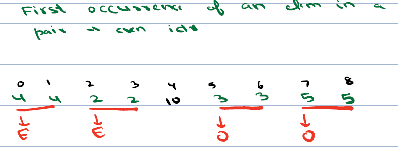

* Before unique element, every duplicate's first occurrence  -> `even`

* After unique element, every duplicate's first occurrence -> `odd`

```java
    public int solve(ArrayList<Integer> A) {
        int left = 0;
        int right = A.size()-1;
        int first =0;
        while(left <= right) {
            int mid = left + (right-left) /2;

            // Ensure mid is not in the beginning or the end
            if((mid == 0 || !A.get(mid).equals(A.get(mid-1))) && (mid == A.size()-1 || !A.get(mid).equals(A.get(mid+1)))) {
                return A.get(mid);
            } 
            if (mid > 0 && A.get(mid).equals(A.get(mid-1))) {
                first = mid-1;
            } else {
                first = mid;
            }
            if(first % 2 == 0) {
                left = first+2;
            } else {
                right = first-1;
            }
        }
        return -1;
    }
```

> `(mid == 0 || !A.get(mid).equals(A.get(mid-1))) && (mid == A.size()-1 || !A.get(mid).equals(A.get(mid+1)))` Checks mid is not first or the last element

> `mid > 0 && A.get(mid).equals(A.get(mid-1))` decides which direction to go.

> `left = first+2`if `first % 2 == 0`

#### Rotated Sorted Array Search

Given a sorted array of integers **A** of size **N** and an integer **B**, where array **A** is rotated at **some pivot** unknown beforehand.  

For example, the array [0, 1, 2, 4, 5, 6, 7] might become [4, 5, 6, 7, 0, 1, 2].  

Your task is to search for the target value B in the array. If **found**, return its **index**; **otherwise**, return **-1**.  

You can assume that **no duplicates** exist in the array.  

**NOTE:** You are expected to solve this problem with a time complexity of **O(log(N))**.

**Psedocode**

* Mid is in first part
  
  * k is in second part -> go right, `l = mid +1`
  
  * k is in first part -> **Compare to normal rule of BS**

* Mid is in second part
  
  * k is in first part -> go left `r = mid-1`
  
  * k is in second part -> **Compare to normal rule of BS**

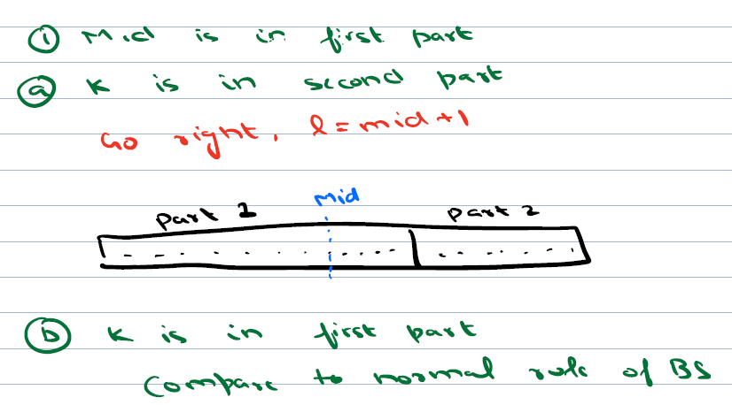

```java
    public int search(final List<Integer> A, int B) {
        int left = 0;
        int right = A.size()-1;

        int mid;
        while(left <= right) {
            mid = left + (right -left)/2;

            if(A[mid] == B) {
                return mid;
            }

            if(A[mid] >= A[0]) { // Mid is in part1
                if(B >= A[0]) { // B is in part1
                    if(A[mid] > B) {
                        right = mid-1;
                    } else {
                        left = mid +1;
                    }
                } else { // B is in part2
                    left = mid+1;
                }
            } else { // Mid is in part2
                if(B >= A[0]) { // B is in part1
                    right = mid-1;
                } else { // B is in part2
                    if(A[mid] > B) {
                        right = mid-1;                    
                    } else {
                        left = mid+1;
                    }
                }        
            }
        }
        return -1;
    }
```

#### Median of two sorted arrays

Given two  **<u>sorted arrays</u>** A and B of size M and N respectively, return the median of the two sorted arrays.  
Round of the value to the floor integer [2.6=2, 2.2=2]

* Median - Middle element in sorted data


```java
   public class Solution {
    public int solve(ArrayList<Integer> A, ArrayList<Integer> B) {

        int M = A.size();
        int N = B.size();
        int total = M+N;
        int firstHalf = (total+1)/2; // In case of even size, +1 will pick exact middle element

        if(M > N) {
            return solve(B, A);
        }
        int l = 0;
        int r = M; // Take the big array

        while(l<=r) {
            int midA = l + (r-l)/2;          

            int l1 = midA==0 ? Integer.MIN_VALUE : A.get(midA-1);
            int r1 = midA==M ? Integer.MAX_VALUE : A.get(midA);

            int midB = firstHalf - midA; // mid number of elements are from A. Remaining ele

            int l2 = midB==0 ? Integer.MIN_VALUE : B.get(midB-1);
            int r2 = midB==N ? Integer.MAX_VALUE : B.get(midB);

            if(l1<=r2 && l2<=r1) {
                int median;
                if(total % 2 ==0) {
                    median = ((l1>l2 ? l1 : l2) + (r1<r2 ? r1 : r2)) / 2; // Take max(l1, l2) and min(r1,r2)
                } else {
                    median = l1>l2 ? l1 : l2; // Take max(l1, l2)
                }
                return median;
            } else if(l1 > r2) {
                r = mid-1;
            } else {
                l = mid+1;
            }
        }
        return 0;
    }
}
```

> :warning: `int firstHalf = (total+1)/2` **1is added**

> `int l1 = mid==0 ? Integer.MIN_VALUE : A.get(mid-1);
>  int r1 = mid==M ? Integer.MAX_VALUE : A.get(mid);` 

## Linked List

* Collection of Nodes

* It has Data and next section

* next pointer of the last node is null

* The memory need not be contigious, it can use free memory available

**Basic operations:**

    Traversal and Search

    Insertion of a node

    Deletion of a node

    Reverse Linked List

    Deep copy of List

    Traverse to node  p

**Traverse through the list:**

```java
        Node temp = head;
        for (int i = 0; i <= p; i++) {
            temp = temp.next;
        }
        return temp;
```

**Insert at index x:**

```java
        Node temp = head;
        Node nn = new Node(a);
        if (x == 0) {
            nn.next = head;
            head = nn;
        } else {
            for (int i = 0; i < x; i++) {
                temp = temp.next;
            }
            nn.next = temp.next;
            temp.next == nn;
            return temp;
        }
```

> :warning:     Handle x==0 seprately

### Delete from Linked List

You are given the head of a linked list **A** and an integer **B**. Delete the **B**-th node from the linked list.

Note : Follow 0-based indexing for the node numbering.

```java
    public ListNode solve(ListNode A, int B) {

        ListNode current = A;
        ListNode prev = null;
        int index = 0;
        if(B==0) {
            current = A.next;
            A.next = null;
            return current;
        }
        while(current != null) {
            if(index == B) {
                prev.next = current.next;
                current.next = null;
                return A;
            }
            prev = current;
            current = current.next;
            index++;
        }
        return A;
    }
```

>     :warning:     Handle x==0 seprately

### Reverse Linked List

```java
    public ListNode reverseList(ListNode A) {
        ListNode prev = null;
        ListNode temp=null;
        ListNode current = A;
        while(current != null) {
            temp = current.next;
            current.next = prev; 
            prev = current;
            current = temp;
        }
        return prev;
    }
```

### Deep copy/Clone Linked List

Each Node has random variable which points to another element in the list

- You are given a **linked list A**
- Each node in the linked list contains two pointers: a **next** pointer and a **random** pointer
- The **next** pointer points to the **next node** in the **list**
- The **random** pointer can point to **any node** in the **list**, or it can be **NULL**
- Your task is to create a **deep copy** of the **linked list A**
- The copied list should be a completely separate linked list from the original list, but with the same **node values** and **random** pointer connections as the original list
- You should create a **new linked list B**, where each **node** in **B** has the same value as the corresponding **node** in **A**
- The **next** and **random** pointers of each **node** in **B** should point to the corresponding **nodes** in **B** (***rather than A***)

**Psedocode:**

1. Create new Linked List as usual by iterating through the existing List

2. Keep current node and new node in a HashMap, **key as current node**

3. Iterate through the old list, get the random node, get the new random node from HashMap and assign it as **random node to new List**

```java
/*
 * Definition for singly-linked list with a random pointer.
 * class RandomListNode {
 *     int label;
 *     RandomListNode next, random;
 *     RandomListNode(int x) { this.label = x; }
 * };
 */
public class Solution {
    public RandomListNode copyRandomList(RandomListNode head) {

        if(head == null) {
            return null;
        }
        RandomListNode headNew = new RandomListNode(head.label);
        RandomListNode tailNew = headNew;

        HashMap<RandomListNode, RandomListNode> hm = new HashMap<>();
        hm.put(head, headNew);

        RandomListNode current = head.next;

        while(current != null) {
            RandomListNode currentNew = new RandomListNode(current.label);
            tailNew.next = currentNew;
            tailNew = currentNew;
            hm.put(current, currentNew);
            current = current.next;
        }

        current = head;
        RandomListNode currentNew = headNew;

        while(currentNew != null) {
            RandomListNode randomNode = current.random;

            if(randomNode != null) {
                currentNew.random = hm.get(randomNode);                
            }
            current = current.next;
            currentNew = currentNew.next;
        }
        return headNew;
    }
}
```

## Stacks

Operations on Stack

```
Push
Pop
Peek
IsEmpty
```

**TC - O(1)**

> Underflow
> Overflow

### Check whether the given sequence of paranthesis is valid

**Psedocode**

```javascript
boolean isValid(String seq) {

    Stack<Character> st = new Stack<>();

    for (int i = 0; i < seq.length(); i++) {

        // If opening bracket, push into stack
        if (seq[i] == '(' || seq[i] == '[' || seq[i] == '{') {
            st.push(seq[i]);
        }
        else {
            // If stack is empty, no matching opening bracket
            if (st.isEmpty()) {
                return false;
            }

            char prev = st.peek();

            // Check whether opening and closing brackets match
            if (isMatching(prev, seq[i])) {

                // Remove matching opening bracket
                st.pop();
            }
            else {
                // Mismatched parentheses
                return false;
            }
        }
    }

    // Valid only if all opening brackets are matched
    return st.isEmpty();
}
```

   ____

### Given a postfix expresstion, evaluate it and return the answer

        **Psedocode**    

```java
    public int evalRPN(ArrayList<String> A) {
        Stack<Integer> st = new Stack<>();

        for(String str:A) {
            Integer op1;
            Integer op2;
            switch(str) {
                case "+":
                    op2 = st.pop();
                    op1 = st.pop();
                    st.push(op1 + op2);
                    break;
                case "-":
                    op2 = st.pop();
                    op1 = st.pop();
                    st.push(op1 - op2);
                    break; 
                case "*":
                    op2 = st.pop();
                    op1 = st.pop();
                    st.push(op1 * op2);
                    break; 
                case "/":
                    op2 = st.pop();
                    op1 = st.pop();
                    st.push(op1 / op2);
                    break;
                default:
                    st.push(Integer.valueOf(str));
            }
        }
        return st.pop();
    }
```

### Nearest smaller element

Given an array A, find the nearest smaller element G[i] for every element A[i] in the array such that the element has an index smaller than i. More formally, G[i] for an element A[i] = an element A[j] such that j is **maximum possible AND j < i AND A[j] < A[i]**
Elements for which no smaller element exist, consider the next smaller element as -1.
**Pseudocode**

* Each time, check top in Stack. If it is bigger than current element, remove from Stack

* If no element is present, add -1 as answer for that particular element

* Insert current element

```java
public ArrayList<Integer> prevSmaller(ArrayList<Integer> A) {
    Stack<Integer> st = new Stack<>();
    ArrayList<Integer> ans = new ArrayList<Integer>(A.size());

    for(int n:A) {            
        while(!st.isEmpty() && st.peek() >= n) {
            st.pop(); // Remove from Stack
        }
        if(!st.isEmpty()) {
            ans.add(st.peek());
        } else {
            //if there is no small ele, add -1
            ans.add(-1);
        }            
        st.push(n); // Push current element to Stack
    }
    return ans;
}
```

**4. Find nearest smaller element on right**
Repeat above, but from right to left

```java
for(int = size-1; i>=0; i--)
```

**5. Find nearest greater element on left**

```java
// index is stored in stack
A[st.pop()] <= A[i]
```

**6. Find nearest greater element on right**
    Repeat above, but from right to left

```java
// index is stored in stack
for(int = size-1; i>=0; i--)
```

## Stacks 2

### Stack impl using Linked List

| Column 1            | Insertion | Deletion |
| ------------------- | --------- | -------- |
| Head                | O(1)      | O(1)     |
| Tail                | O(n)      | O(n)     |
| Tail(maintain tail) | O(1)      | O(1)     |

### Common problems

#### Double character trouble

To transform the string, you should perform the following operation repeatedly:
Identify the first occurrence of consecutive identical pairs of characters within the string.
Remove this pair of identical characters from the string.
Repeat steps 1 and 2 until there are no more consecutive identical pairs of characters.
The final result will be the transformed string.
**Psedocode**

```java
public String solve(String A) {
    Stack<Character> st = new Stack<>();
    for(int i=0; i<A.length(); i++) {
        if(!st.isEmpty() && st.peek().equals(A.charAt(i))) {
            st.pop();
        } else {
            st.push(A.charAt(i));
        }
    }
    StringBuilder temp= new StringBuilder();
    while(!st.isEmpty()) {
        temp.append(st.pop());            
    }
    return temp.reverse().toString();
}
```

> :bulb: **Hint**     Use StringBuilder to reverse String efficiently

#### Largest Rectangle in Histogram

Given an array of integers A.
A represents a histogram i.e A[i] denotes the height of the ith histogram's bar. Width of each bar is 1.
Find the area of the largest rectangle formed by the histogram.


**Psedocode**

> :clipboard: **Note:**    At each bar, find out the max rectangle that can be formed.

```javascript
l = nearest smaller element on left
r = nearest smaller element on right
width = r-l-1
height = A[i]
area = ht * width
ans_area = max(ans_area, area)
```

```java
    public int largestRectangleArea(ArrayList<Integer> A) {
        int size=A.size();

        Stack<Integer> st = new Stack<>();

        // Lists to maintain nearest small elements
        ArrayList<Integer> nsl = new ArrayList<Integer>();
        ArrayList<Integer> nsr = new ArrayList<Integer>(Collections.nCopies(size, -1));

        // Find NSL
        for(int i=0; i<size; i++) {
            while(!st.isEmpty() && A.get(st.peek()) >= A.get(i)) {
                st.pop(); // Remove from Stack
            }
            if(!st.isEmpty()) {
                nsl.add(st.peek());
            } else {
                nsl.add(-1);
            }
            st.push(i);
        }
        // Find NSR
        st = new Stack<>();
        for(int j=size-1; j>=0;  j--) {
            while(!st.isEmpty() && A.get(st.peek()) >= A.get(j)) {
                st.pop();
            }
            if(!st.isEmpty()) {
                nsr.set(j, st.peek());
            } else {
                nsr.set(j, size);
            }
            st.push(j);
        }
        // Find max windows size
        int ans = 0;
        for(int i=0; i<size; i++) {
            int current = (nsr.get(i)-nsl.get(i)-1) * A.get(i);
            ans = ans > current ? ans : current;
        }
        return ans;
    }
```

#### MAX and MIN

Given an array of integers **A**.

The value of an array is computed as the difference between the **maximum** element in the array and the **minimum** element in the array **A**.

Calculate and return the sum of values of all possible subarrays of A **modulo $10^9+7$**.

**Psedocode**

> :clipboard: **Note:**    Find contribution of each element and add to answer.

```js
Find => NGL, NGR, NSL, NSR
No. of sub arrays in which A[i] is max = (i-l) * (r-i)
Contribution of A[i] for sum_max = A[i] * <No. of sub arrays in which A[i] is max>

sum_max = Contribution of A[0] + Contribution of A[0] + ... + A[i] * <No. of sub arrays in which A[i] is max>

Contribution of A[i] for sum_min = A[i] * <No. of sub arrays in which A[i] is min>
sum_min = Contribution of A[0] + Contribution of A[0] + ... + A[i] * <No. of sub arrays in which A[i] is max>

ans = sum_max - sum_min
```

> :bulb: Refer to Sample programs or Eclipse for the complete code.

## Queues

* Linear data structure where items are added at one end and removed from the other end.

* FIFO

Common operations:

1. Enque - add elements at the end/back. push in some languages

2. Deque - remove elements from front of the queue. pop

3. Peek or Front - returns element from front (With out removing)

4. isEmpty()

5. size/length()

**TC  of all operations-** $O(1)$

### Implementation of queue

#### Using fixed size array

**Enque**

```java
r++;
if(f == -1) {
    f++;
}
A[r] = new_ele;
```

**Enque using circular array**

```java
r = (r+1) % capacity;
```

:warning: **Note:** This  solves the issue of **space wasted by deque**. How ever it does not solve the capacity problem.

**Deque**

```java
f++;
```

> :bulb: `size < capacity` => Insertion possible
> 
> :bulb: `size == capacity` => Overflow

**Dynamic array:**

**Psedocode**

```java
class Queue {
    int[] ar;
    int f, r, size, capacity;

    Queue(int limit) {
        capacity = limit;
        ar = new int[capacity];
        size = 0;
        f = r = -1;
    }
    void enque(ine ele) {
        if(size == capacity) {
            throw OVERFLOW;
        }
        r = (r+1)%capacity; // Do % capacity to reuse earlier available indexes
        ar[r] = ele;
        size++;
        if (f == -1) {
            f++;
        }
    }
    void deque() {
        if(isEmpty()) {
            throw UNDERFLOW;
        }
        f = (f+1)%capacity; // Do % capacity to reuse earlier available indexes
        size--;
    }
    bool isEmpty() {
        return size == 0;
    }
    int peek/front() {
        if(isEmpty()) {
            throw UNDERFLOW;
        }
        return ar[f];    
    }
    bool isFull() {
      return size == capacity;
    }
}
```

##### Print Queue

```java
if(size != 0) {
    for(int i=f; i<=r ; i=(i+1)%capacity) { // % capacity is required, in case f > r. Possible in impl using Circular array
        print(a[i]);
    }
}
```

#### Using Linked List

**Approach 1:**

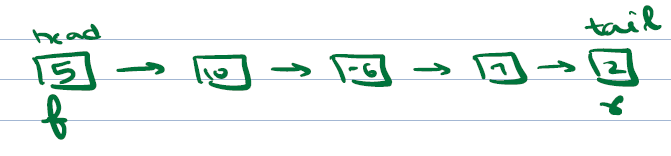

Deletion at front -> $O(1)$

Insertion at rear (provided we maintain tail) -> $O(1)$

**Approach 2:**

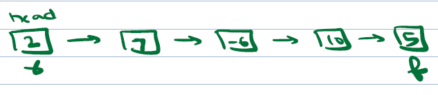

Deletion at front -> $O(n)$

Insertion at rear -> $O(1)$

> :bulb: **Approach 1 is better** => `head -> f, tail -> r`

**Psedocode**

```java
/**
 * Your UserQueue object will be instantiated and called as such:
 * UserQueue obj = new UserQueue();
 * obj.push(X);
 * int param2 = obj.pop();
 * int param3 = obj.peek();
 * boolean param4 = obj.empty();
 */

 public static class UserQueue {
    /** Initialize your data structure here. */
    Stack<Integer> mainStack;
    Stack<Integer> auxStack;
    UserQueue() {
        mainStack = new Stack<>();
        auxStack = new Stack<>(); // Aux Stack is used
    }

    /** Push element X to the back of queue. */
    void push(int X) {
        mainStack.push(X);
    }

    /** Removes the element from in front of queue and returns that element. */
    int pop() {
        copyMainToAux(); // Copy each time conditionally
        return auxStack.pop();
    }

    /** Get the front element of the queue. */
    int peek() {
        copyMainToAux(); // Copy each time conditionally
        return auxStack.peek();        
    }

    boolean empty() {
        return mainStack.isEmpty() && auxStack.isEmpty(); // Check both the Stacks
    }

    void copyMainToAux() {
        if(auxStack.isEmpty()) {
            while(!mainStack.isEmpty()) {
                auxStack.push(mainStack.pop());
            }
        }
    }
}
```

> **TC:** 

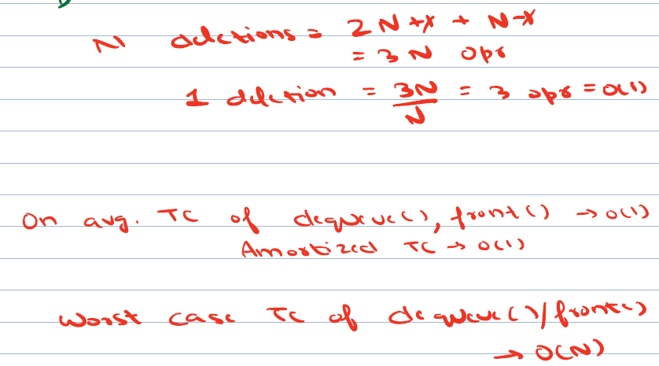

### Double ended Queue (Deque)

* Insertion and Deletion at both end

* Implemented using doubly linked list

`push_front()`

`push_rear()`

`pop_front`

`pop_rear`

`front()`

`back()`

## Trees

- Access data in sequential order

- `Non linear data structure` used to represent heirarchy information. ex - **Family tree, org tree, folder structure**

- `Linear data structures` - Access data in sequential order. ex - **Array, Linked List, Stack, Queues, etc**

- `Node, Root, Parent, Child, Leaf` - Node with zero children

- `Depth/level `- distance from root

- `Height `- Length of longest path from a node to leaf

- `siblings `- node that share same parent node

- `Ancestor `- all nodes from parent to root node

- `Descendent `- All nodes from child to leaf node along all paths

### Binary Tree

* Each node can have `max of 2 children`. either `0 or 1 or 2`

* `Proper Binary Tree` - Every node has` 0 or 2 childern`

* `Complete Binary Tree` - All levels are filled<mark> except possibly last level</mark>. `Last levels` are filled from` left to right `partially

* `Perfect Binary Tree` - All levels are completely filled
  
  * All leaf nodes are at same level
  
  * Internal nodes have exactly 2 children

* `Perfect BT` is `proper `and `complete`

#### Traversal

1. Preorder - NLR

2. Inorder - LNR

3. Postorder - LRN

##### Psedocode

**Preorder**

```java
void preorder(TreeNode node) {
    if(root == null) {
        return;
    }
    print(root.data);
    preorder(root.left);
    preorder(root.right)
}
```

**InOrder**

```java
void inOrder(TreeNode node) {
    if(root == null) {
        return;
    }
    inOrder(root.left);
    print(root.data);
    inOrder(root.right)
}
```

**PostOrder**

```java
void postOrder(TreeNode node) {
    if(root == null) {
        return;
    }
    postOrder(root.left);
    postOrder(root.right);
    print(root.data);
}
```

> **SC:** $O(H)$ -> Height of the tree -> $log(N)$ or $N$
> 
> At any point, **nodes of 1 path are on the stack**. We are exploring nodes path by path.

#### Level Order Traversal

* Print all nodes level by level starting from $L0$

* Keep adding left, right nodes in the queue as you visit the node

* At any point either the nodes of **a particular level is in the Stack or nodes of two consecutive levels**

* Queue - `Insert `at `end`, `Deletion` at `first`

```java
Queue<TreeNode> q;
q.enque(root);

while(!q.isEmpty) {
    Node cur = q.front();
    q.deque(); // Access and remove element from Queue
    print(cur.data);
    if(cur.left != null) {
        q.enque(cur.left); // Add left node to Queue
    }
    if(cur.right != null) {
        q.enque(cur.right ); // Add right node to Queue
    }
}
```

> **TC:** $O(N)$
> 
> **SC:** $O(N)$ -> Last level contains `N/2` elements in a full Tree. This will be the max space utilized in the iteration based on level.

**Print levels in new line**

```java
Queue<TreeNode> q;
q.enque(root);

while(!q.isEmpty) {
    int levelSize = q.size(); // Currently queue contains the nodes of the particular level
    for(int i=1; i<=levelSize; i++) {
        Node cur = q.front();
        q.deque();
        print(cur.data);
        if(cur.left != null) {
            q.enque(cur.left);
        }
        if(cur.right != null) {
            q.enque(cur.right );
        }
    }
    print("\n");
}
```

#### Print last node of every level

```java
while(q.isEmpty) {
    int levelSize = q.size(); // Currently queue contains the nodes of the particular level
    for(int i=1; i<=levelSize; i++) {
        Node cur = q.front();
        q.deque();
        if(i == levelSize) // Print only if the counter == levelSize
            print(cur.data);
        if(cur.left != null) {
            q.enque(cur.left);
        }
        if(cur.right != null) {
            q.enque(cur.right );
        }
    }
    print("\n");
}
```

### Binary Search Tree

* For any node in BST, `LST <= x && RST > x` => `L <= N < R`

* `In Order Traversal` of BST gives `Sorted array`

* We can search faster in BST as it implicitly follows`devide and conqure` technique

#### Search in BST

```java
boolean search(Node root, int val) {
    Node temp = root;
    while(temp != null) {
        if(temp.val == val)
            return true;
        else if(temp.val < val)
            temp = temp.right;
        else
            temp = temp.left;    
    }
    return false;
}
```

**Skewed Tree**

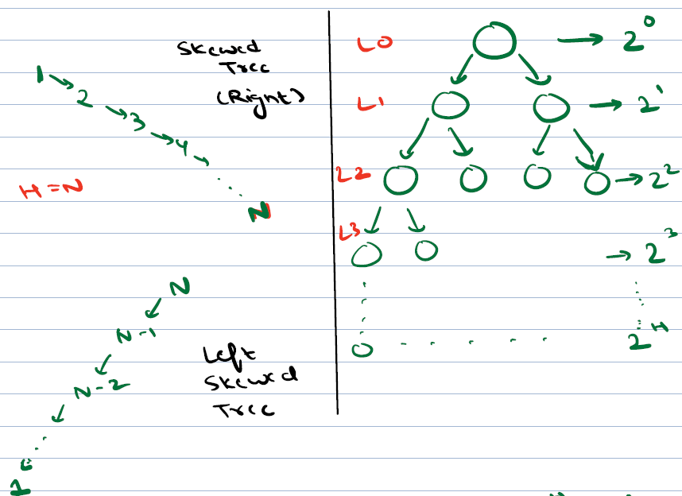

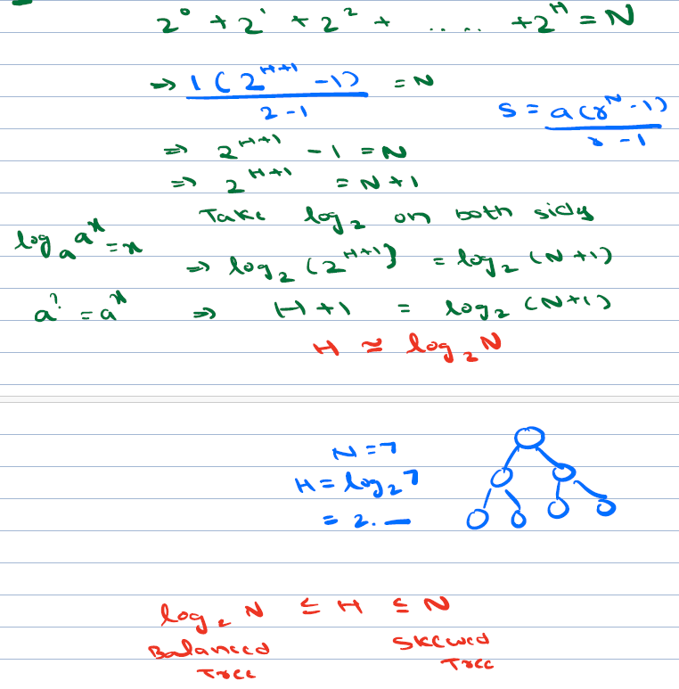

#### Problems

**Find smallest node/minimum in BST**

Left most node is smallest

```java

```

**TC:** $O(H)$

**SC:**$O(1)$

**Find largest node/maximum in BST**

Right most node is biggest

```java

```

**TC:** O(H)

**SC:**$O(1)$

**Insert a node in BST**

```java
Node nn = new Node(x);

if(root == null)
    return nn;
Node temp = root, prev = null;

while(temp != null) { // Iterate till leaf
    prev = temp;
    if(temp.data < x)
        temp = temp.right;
    else // temp.data >= x
        temp = temp.left;
}
if(prev.data < x)
    prev.right = nn;
else
    prev.left = nn;
return root;
```

#### Delete a node in BST

* Use Recursion
* Return below if node to be deleted has below child  ->
  * No child (Leaf node) - Return null.
  * Single child - Return the single child.
  * Two children - Return `max element from LST` or `min element from RST`
    * Replace the node with `max element from LST` or replace it with `min element from RST`
    * Call delete method from the node which was having value to be deleted.

```java
public class Solution {
    public TreeNode solve(TreeNode A, int B) {
        TreeNode node = A;

        if(node == null) 
            return null;

        if(node.val < B) {
            node.right = solve(node.right, B);
        } else if (node.val > B) {
            node.left = solve(node.left, B);
        }
        else { // node.val == B
            if(node.right == null && node.left == null) // node has no children
                return null;
            else if(node.right == null || node.left == null) { // node has one child
                if(node.left == null)
                    return node.right;
                else
                    return node.left;
            } else { // node has two children
                TreeNode temp = node.left; // Take max from LST

                while(temp.right != null) {
                    temp = temp.right;
                }
                // swap nodes
                int tempVal = temp.val;
                temp.val = node.val;
                node.val = tempVal;

                // Again call solve() method to delete from the node with value to be deleted
                node.left = solve(node.left, B);
                return node;
            }
        }
        return node;       
    }
}
```

#### Construct Binary Tree from Sorted Array

* Split the array at `mid `element and do `recursive `to add `left `and `right `element

* At leaf node, it will stop by add null left and right nodes

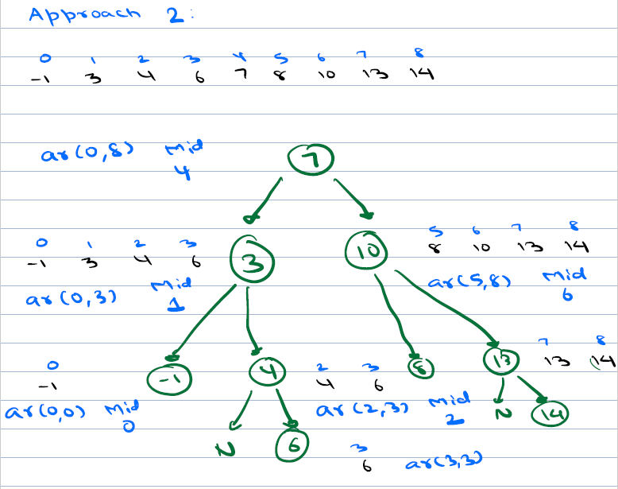

```java
    public TreeNode sortedArrayToBST(final int[] A) {
        return constructTree(A, 0, A.length-1);
    }
    TreeNode constructTree(int[] A, int s, int e) {
        if(s > e) {
            return null;
        }

        int mid = s + (e-s)/2;
        TreeNode nn = new TreeNode(A[mid]);
        nn.left = constructTree(A, s, mid-1);
        nn.right = constructTree(A, mid+1, e);
        return nn;
    }
```

> **TC:** $O(N)$ -> Every time one node gets created. In other words, each node is visited once.
> 
> **SC:** $O(H)$ 

#### Check if BST is valid

* Keep class level variables - `prev `and `ans`.

* Keep `prev `variable to maintain previously visited Node, the visiting node is in **in-order traversal**.

* Do the `inorder traversal` while checking for valid BST

* `prev` will hold the **left child, parent node, right child** in this particular order during this iteration.


```java
public class Solution {
    TreeNode prev = null;

    public int isValidBST(TreeNode A) {       
        return checkBST(A) ? 1 : 0;
    }

    private boolean checkBST(TreeNode root) {
        if(root == null)
            return true;

        if(!checkBST(root.left))
            return false;

        if(null != prev && root.val < prev.val)
            return false;

        prev = root;
        return (checkBST(root.right));
    }
}
```

### Binary Trees - Lab excercises

#### Split BST into equal subtrees

**Psedocode**

* Find total sum. `sum/2` will be desired sum of sub tree

* Traverse through LST and RST including all subtrees, identify if the sub tree total = desiredTotalValue

```java
public class Solution {
    int ans = 0;

    public int solve(TreeNode A) {
        if(A == null ) return 0;
        long sum = calcTotalSum(A);
        if(sum % 2 == 1)
            return 0;        
        checkSum(A, A, sum/2);
        return ans;
    }

    long checkSum(TreeNode A, TreeNode root, long desiredValue) {
        if(A == null) return 0;
        if(ans == 1) return 1; // early return as soon as it finds tree can be split

        long subtreeSum = checkSum(A.left, root, desiredValue) + checkSum(A.right, root, desiredValue) + A.val;

        if(subtreeSum == desiredValue && A != root) // includes case if node is root, only one node and value is 0
            ans = 1;      
        return subtreeSum;
    }

    long calcTotalSum(TreeNode A) {
        if(A == null)
            return 0;
        return calcTotalSum(A.left) + calcTotalSum(A.right) + A.val;
    }    
}
```

> :bulb: `node != root && ans==1`
> 
> 1. Exit the iteration as soon as match found.
> 
> 2. Ignores the root of the tree. It will incorrectly return `TRUE `at the root node otherwise.
> 
> **TC:** $O(H)$
> 
> **SC:** $O(N)$

**Approach2: Using HashSet**

This can be complete in a single pass using HashSet. Better than approach1.

```java
public class Solution {

    Set<Long> sums = new HashSet<>(); // To maintain the sum at each node

    public int solve(TreeNode A) {
        long total = dfs(A);

        if (total % 2 != 0) return 0;

        sums.remove(total); // remove whole tree

        return sums.contains(total / 2) ? 1 : 0;
    }

    private long dfs(TreeNode node) {
        if (node == null) return 0;

        long sum = node.val + dfs(node.left) + dfs(node.right);
        sums.add(sum); // Add each and every sum calculated in the Hashset

        return sum;
    }
}
```

#### Path Sum

Given a binary tree and a sum, determine if the tree has a root-to-leaf path such that adding up all the values along the path equals the given sum.

```java
boolean checkPathSum(Node root, int k) {
    if(root == null)
        return false;

    if(root.left == null && root.right == null) // Check the condition at the leaf node
        return root.val == k;

    // First check the left most tree. While coming back up, traverse each possible RST
    return checkPathSum(root.left, k-root.val) || checkPathSum(root.right, k-root.val); //subtract root val from k at each node
}
```

> **TC:** $O(N)$
> 
> **SC:** $O(H)$

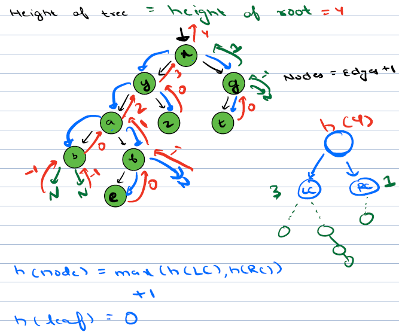

#### Find height of Binary Tree

:book: Number of Nodes = Number of Edges + 1

```java
int findHeight(Tree node) {
    if(node == null)
        return -1; // return -1
    int lh = findHeight(node.left);
    int rh = findHeight(node.right);
    return max(lh, rh) + 1; // Add one to max
}
```

#### Check if its Balanced Binary Tree

:book: A tree is height balanced if at every node =>

                    $|LST_h - RST_h| <=1 $

```java
boolean ans = true;
int checkTreeHeight(Tree root) {
    if(root == null)
        return -1;
    int lh = checkedTreeHeight(root.left);
    int rh = checkedTreeHeight(root.right);
    if( abs(lh - rh) > 1)
        ans = false;
    return max(lh, rh) + 1;
}
```

#### Construct Binary Tree

Given the **inorder and postorder** traversal of a tree, construct the binary tree.

**NOTE:** You may assume that duplicates do not exist in the tree.

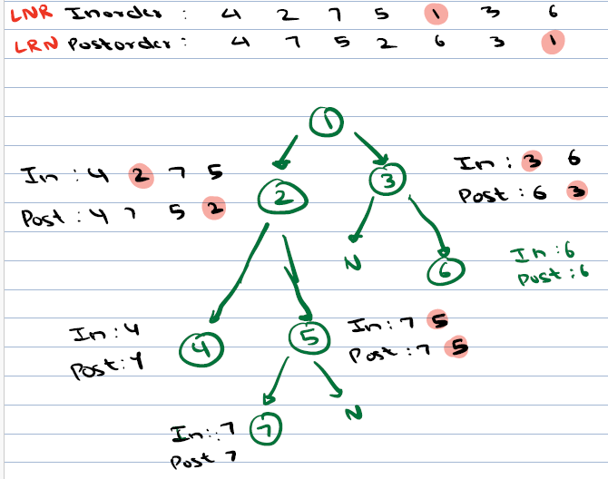

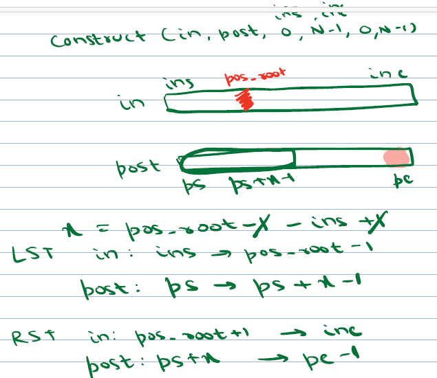

```java
public class Solution {
    public TreeNode buildTree(int[] A, int[] B) {
        int is = 0;
        int ie = A.length-1;
        int ps = 0;
        int pe = B.length-1;
        return constructTree(A, B, is, ie,ps, pe);
    }
    // Recursive method
    TreeNode constructTree(int[] A, int[] B, int ins, int ine, int ps, int pe) {

        if(ins > ine) { // base condition to stop navigating
            return null;
        }

        int rootVal = B[pe]; // End index has root value in in-order traversal

        // Identify the index of root in in-order array
        int rootPosIO =-1;
        for(int i=ins; i <= ine; i++) {
            if(A[i] == rootVal) {
                rootPosIO = i;
                break;
            }                
        }
        TreeNode nn = new TreeNode(rootVal);
        int x = rootPosIO - ins; // To find the root position in Post Order array. ps+x is the next root place in PO
        nn.left = constructTree(A, B, ins, rootPosIO-1, ps, ps+x-1); // element at rootPos is ignored as its added to root
        nn.right = constructTree(A, B, rootPosIO+1, ine, ps+x, pe-1); // Element at pe ignored as this element is added as root
        return nn;
    }
}
```

### Data structure to use in DSA

| Problem requirement                        | Recommended data structure  |
| ------------------------------------------ | --------------------------- |
| Matching parentheses                       | Stack                       |
| Next Greater Element                       | Stack                       |
| Sliding Window Maximum                     | Deque                       |
| BFS traversal                              | Queue                       |
| Level Order Traversal                      | Queue                       |
| Kth Largest / Smallest                     | PriorityQueue               |
| Top K frequent elements                    | PriorityQueue + HashMap     |
| Shortest Path (Dijkstra)                   | PriorityQueue               |
| Unique elements                            | HashSet                     |
| Sorted unique elements                     | TreeSet                     |
| Frequency counting                         | HashMap                     |
| LRU Cache                                  | HashMap + Doubly LinkedList |
| Dynamic array                              | ArrayList                   |
| Min / Max element with efficient retrieval | PriorityQueue               |

### Time complexity comparison

This is particularly important for DSA problems.

| Data structure     | Insert   | Remove   | Search / Access | Peek / Get top |
| ------------------ | -------- | -------- | --------------- | -------------- |
| Stack (Vector)     | O(1)*    | O(1)*    | O(N)            | O(1)           |
| Queue (LinkedList) | O(1)     | O(1)     | O(N)            | O(1)           |
| PriorityQueue      | O(log N) | O(log N) | O(N)            | O(1)           |
| ArrayDeque         | O(1)*    | O(1)*    | O(N)            | O(1)           |
| ArrayList          | O(1)*    | O(N)     | O(N)            | O(1) by index  |
| LinkedList         | O(1)**   | O(N)     | O(N)            | O(1) at ends   |
| HashSet            | O(1)*    | O(1)*    | O(1)*           | N/A            |
| TreeSet            | O(log N) | O(log N) | O(log N)        | O(log N)       |
| HashMap            | O(1)*    | O(1)*    | O(1)*           | N/A            |
