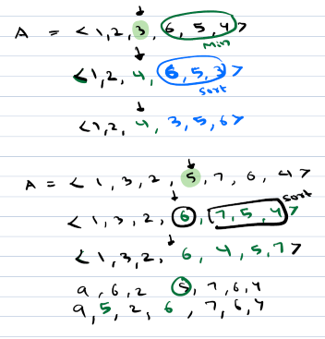
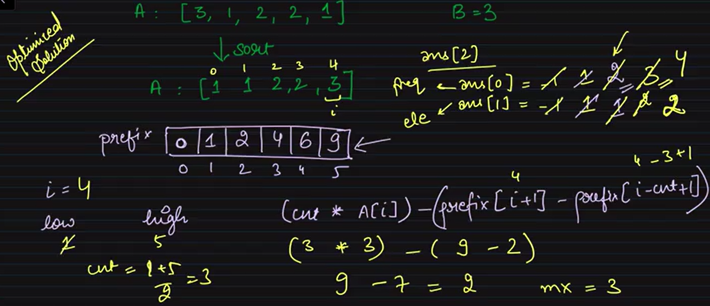
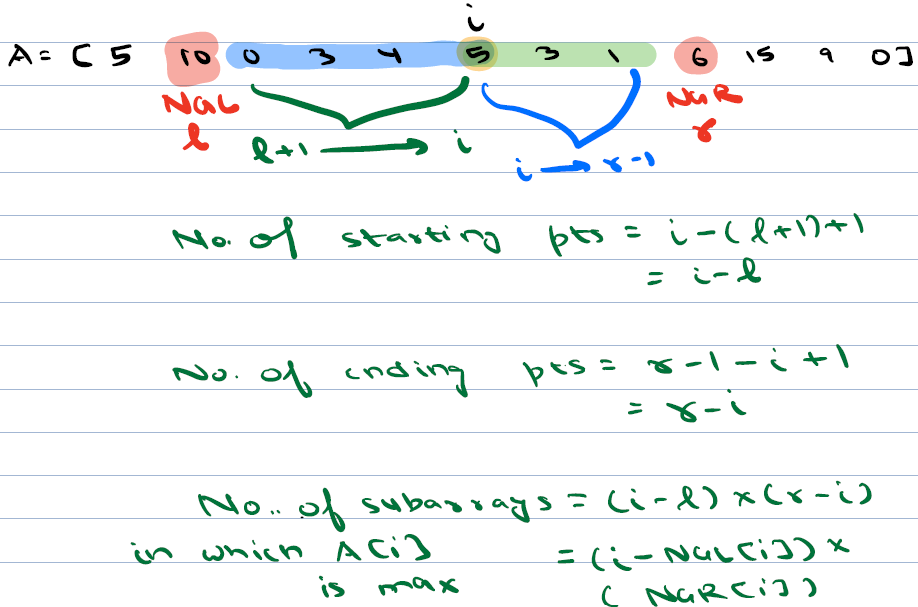
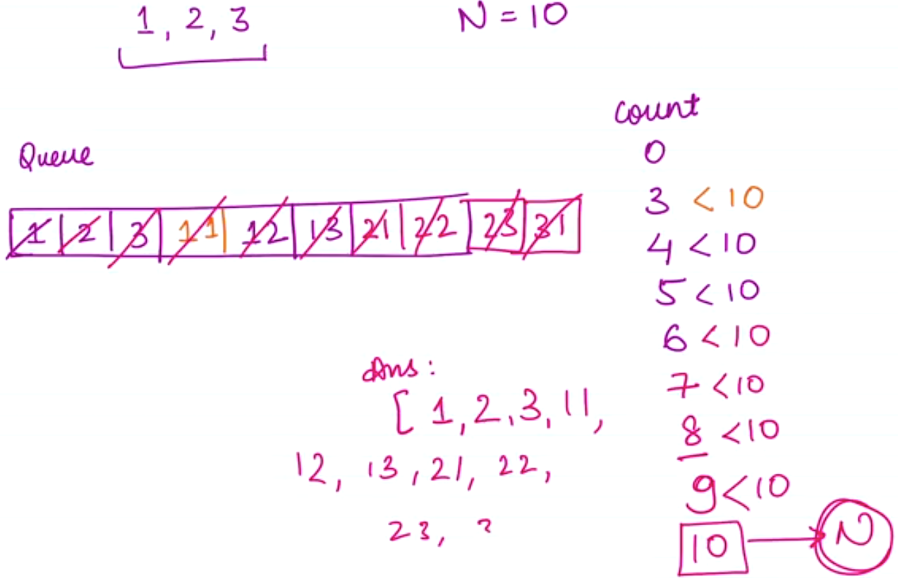

[TOC]

## Advanced DSA 2

### Arrays

#### Next Permutation

**Problem Description**  

Implement the **next permutation**, which rearranges numbers into the numerically next greater permutation of numbers for a given array **A** of size **N**.

If such arrangement is not possible, it must be rearranged as the lowest possible order, i.e., sorted in ascending order.

**NOTE:**

- The replacement must be in-place, do **not** allocate extra memory.
- DO NOT USE LIBRARY FUNCTION FOR NEXT PERMUTATION. Use of Library functions will disqualify your submission retroactively and will give you penalty points.



```java
public class Solution {
    public ArrayList<Integer> nextPermutation(ArrayList<Integer> A) {
        int n = A.size();
        int i=n-2;

        // Find where ascending order is breaking whiel coming in reverse
        // Ex: 9 6 5 8 2 => i=2
        while(i>=0) {
            if(A.get(i) < A.get(i+1)) {
                break;
            }
            i--;
        }
        // If ascensing order while coming in reverse is not found, it is 7 6 4 2, 
        // next sequence will be complete reverse of it -> 2 4 6 7
        if(i == -1) {
            reverse(A);
            return A;
        }

        // Find item to swap
        // Ex: 9 6 5 8 2 => i=2, j=3
        int j=n-1;
        while(j > i) {
            if(A.get(j) > A.get(i)) {
                break;
            }
            j--;
        }

        // Swap i, j elements. After swap = 9 6 8 5 2
        int temp = A.get(j);
        A.set(j, A.get(i));
        A.set(i, temp);
        // After revers = 9 6 8 2 5
        reverse(A, i);
        return A;
    }
    private void reverse(ArrayList<Integer> A) {
        int n = A.size();
        for(int k=0; k<=(n-1)/2;k++) {
            int temp1 = A.get(k);
            A.set(k, A.get(n-1-k));
            A.set(n-1-k, temp1);
        }
    }
    private void reverse(ArrayList<Integer> A, int i) {
        int s = i+1;
        int e = A.size()-1;
        while(s < e) {
            int temp1 = A.get(s);
            A.set(s, A.get(e));
            A.set(e, temp1);
            s++;
            e--;
        }
    }
}
```

### Binary Search

#### Painters problem

**Problem Description**  

Given 2 integers **A** and **B** and an array of integers **C** of size **N**. Element **C[i]** represents the length of **ith** board.  
You have to paint all **N** boards **[C0, C1, C2, C3 … CN-1]**. There are **A** painters available and each of them takes **B** units of time to paint **1 unit** of the board.

Calculate and return the minimum time required to paint all boards under the constraints that **any painter will only paint contiguous sections of the board.**

**NOTE:**  
**1.** 2 painters cannot share a board to paint. That is to say, a board cannot be painted partially by one painter, and partially by another.  
**2.** A painter will only paint contiguous boards. This means a configuration where painter 1 paints boards 1 and 3 but not 2 is invalid.  

Return the **ans % 10000003**.

**Problem Constraints**  

1 <= A <= 1000  
1 <= B <= 106  
1 <= N <= 105  
1 <= C[i] <= 106

```java
public class Solution {
    public int paint(int A, int B, ArrayList<Integer> C) {
        long left = C.get(0);
        long right = 0;
        for(int n:C) {
            left = left > n ? left : n;
            right += n;
        }
        long mid=0;
        int count =0;
        long ans = 0l;
        while(left <= right) {
            mid = left + (right-left)/2;
            if(isItPossibleToPaint(A, B,C, mid)) {
                ans = mid;
                right = mid -1;
            } else {
                left = mid +1;
            }
        }
        return (int) (ans%10000003 * B%10000003)%10000003;        
    }

    private boolean isItPossibleToPaint(int A, int B, ArrayList<Integer> C, long n) {
        long work=0 ;
        int count = 1;
        for(int i=0; i<C.size(); i++) {
            if(work + (long) C.get(i) <= n) {
                work += (long) C.get(i);
            } else {
                count++;
                work = (long) C.get(i);
            }
        }
        return count <= A;
    }
}
```

#### Library books distribution

Given an array of integers **A** of size **N** and an integer **B**.

The College library has **N** books. The **ith** book has **A[i]** number of pages.

You have to allocate books to **B** number of students so that the <mark>maximum number of pages allocated to a student is minimum</mark>.

A book will be allocated to **exactly one student**.
Each student has to be allocated **at least one book**.
Allotment should be in **contiguous order**, for example: A student cannot be allocated book 1 and book 3, skipping book 2.

Calculate and return that **minimum** possible number.

**NOTE:** Return **-1** if a valid assignment is not possible.

```java
public class Solution {
    public int books(ArrayList<Integer> A, int B) {
        if(A.size() < B) {
            return -1;
        }

        long left = 1;
        long right=0;
        for(int n:A) {
            left = left > n ? left : n;
            right += n;
        }
        long ans = -1;
        while (left <= right) {
            long mid = left + (right-left)/2;
            if(canAllocateBooks(A, B, mid)) {
                ans = mid;
                right = mid-1;
            } else {
                left = mid+1;
            }
        }
        return (int) ans;
    }

    boolean canAllocateBooks(ArrayList<Integer> A, int B, long T) {
        int count = 1;
        long total = 0l;
        for(int i=0; i<A.size(); i++) {
            if(A.get(i) > T) {
                return false;
            }
            if(total + (long) A.get(i) <= T) {
                total += A.get(i);
            } else {
                total = A.get(i);
                count++;
            }
        }
        return count <= B;
    }
}
```

> `A.get(i) > T` - The book with pages more than `T` cant be allocated to a single Student

> `total + (long) A.get(i) <= T`

> `count <= B`

#### Add or Not

**Problem Description**  

Given an array of integers **A** of size **N** and an integer **B**.

In a single operation, any one element of the array can be increased by 1. You are allowed to do at most **B** such operations.

Find the number with the **maximum** number of occurrences and return an array **C** of size 2, where **C[0]** is the number of occurrences, and **C[1]** is the number with maximum occurrence.  
If there are several such numbers, your task is to find the **minimum** one.

**Problem Constraints**  

1 <= N <= 105

-109 <= A[i] <= 109

0 <= B <= 109



### Linked List

#### Clone/Deep copy of Linked List

- You are given a **linked list A**
- Each node in the linked list contains two pointers: a **next** pointer and a **random** pointer
- The **next** pointer points to the **next node** in the **list**
- The **random** pointer can point to **any node** in the **list**, or it can be **NULL**
- Your task is to create a **deep copy** of the **linked list A**
- The copied list should be a completely separate linked list from the original list, but with the same **node values** and **random** pointer connections as the original list
- You should create a **new linked list B**, where each **node** in **B** has the same value as the corresponding **node** in **A**
- The **next** and **random** pointers of each **node** in **B** should point to the corresponding **nodes** in **B** (***rather than A***)

```java
    public RandomListNode copyRandomList(RandomListNode head) {

        if(head == null) {
            return null;
        }
        RandomListNode head1 = new RandomListNode(head.label);
        RandomListNode tail1 = head1;

        HashMap<RandomListNode, RandomListNode> hm = new HashMap<>();
        hm.put(head, head1);

        RandomListNode current = head.next;

        while(current != null) {
            RandomListNode current1 = new RandomListNode(current.label);
            tail1.next = current1;
            tail1 = current1;
            hm.put(current, current1);
            current = current.next;
        }

        current = head;
        RandomListNode current1 = head1;

        while(current1 != null) {
            RandomListNode randomNode = current.random;

            if(randomNode != null) {
                current1.random = hm.get(randomNode);                
            }
            current = current.next;
            current1 = current1.next;
        }
        return head1;
    }
```

### Stack

#### Largest Rectangle

Refer the DSA Notes.

#### MAX and MIN

Given an array of integers **A**.

The value of an array is computed as the difference between the **maximum** element in the array and the **minimum** element in the array **A**.

Calculate and return the sum of values of all possible subarrays of A **modulo $10^9+7$**.

**Psedocode**

> :clipboard: **Note:**    Find contribution of each element and add to answer.



```js
Find => NGL, NGR, NSL, NSR
No. of sub arrays in which A[i] is max = (i-l) * (r-i)
Contribution of A[i] for sum_max = A[i] * <No. of sub arrays in which A[i] is max>

sum_max = Contribution of A[0] + Contribution of A[0] + ... + A[i] * <No. of sub arrays in which A[i] is max>

Contribution of A[i] for sum_min = A[i] * <No. of sub arrays in which A[i] is min>
sum_min = Contribution of A[0] + Contribution of A[0] + ... + A[i] * <No. of sub arrays in which A[i] is max>

ans = sum_max - sum_min
```

```java
public class Solution {
public int solve(ArrayList<Integer> A) {
        ArrayList<Integer> ngl = findNGL(A);
        ArrayList<Integer> ngr = findNGR(A);
        ArrayList<Integer> nsl = findNSL(A);
        ArrayList<Integer> nsr = findNSR(A);

        int size = A.size();
        int mod = 1000000007;

        // find max sum
        int sumMax = 0;
        for (int i = 0; i < size; i++) {
            long left = i - ngl.get(i);
            long right = ngr.get(i) - i;
            long sum = (long) (A.get(i) * left * right) % mod;
            sumMax = (sumMax + (int) sum) % mod;
        }
        int sumMin = 0;
        for (int i = 0; i < size; i++) {
            long left = i - nsl.get(i);
            long right = nsr.get(i) - i;
            long sum = ((long) A.get(i) * left * right) % mod;
            sumMin = (sumMin + (int) sum) % mod;
        }
        return (sumMax - sumMin + mod) % mod; // Add mod to avoid a negative difference coming at times
    }

    ArrayList<Integer> findNGL(ArrayList<Integer> A) {
        Stack<Integer> st = new Stack<>();
        ArrayList<Integer> ans = new ArrayList<Integer>();

        for(int i=0; i<A.size(); i++) {
            while(!st.isEmpty() && A.get(st.peek()) < A.get(i)) { // Remove elements lesser than current element
                st.pop();
            }            
            if(!st.isEmpty()) {
                ans.add(st.peek());
            } else {
                ans.add(-1); // No greater element is available. All indexes to left will be eligible
            }
            st.push(i);
        }
        return ans;
    }
    ArrayList<Integer> findNGR(ArrayList<Integer> A) {
        Stack<Integer> st = new Stack<>();
        int size = A.size();
        ArrayList<Integer> ans = new ArrayList<Integer>(Collections.nCopies(size, size)); // Initialize for full size

        for(int i=size-1; i>=0; i--) {
            while(!st.isEmpty() && A.get(st.peek()) <= A.get(i)) {
                st.pop();
            }
            if(!st.isEmpty()) 
                ans.set(i, st.peek());
            st.push(i);
        }
        return ans;
    }
    ArrayList<Integer> findNSL(ArrayList<Integer> A) {
        Stack<Integer> st = new Stack<>();
        ArrayList<Integer> ans = new ArrayList<Integer>();
        for(int i=0; i<A.size(); i++) {
            while(!st.isEmpty() && A.get(st.peek()) > A.get(i)) {
                st.pop();
            }
            if(!st.isEmpty()) {
                ans.add(st.peek());
            } else {
                ans.add(-1); // No greater element is available. All indexes to left will be eligible
            }
            st.push(i);
        }
        return ans;
    }
    ArrayList<Integer> findNSR(ArrayList<Integer> A) {
        Stack<Integer> st = new Stack<>();
        int size = A.size();
        ArrayList<Integer> ans = new ArrayList<Integer>(Collections.nCopies(size, size)); // Initialize for full size

        for(int i=size-1; i>=0; i--) {
            while(!st.isEmpty() && A.get(st.peek()) >= A.get(i)) {
                st.pop();
            }
            if(!st.isEmpty()) 
                ans.set(i,st.peek());
            st.push(i);
        }
        return ans;
    }      
}
```

### Queue

#### Queue implementation using Stack

```java
public static class UserQueue {
    /** Initialize your data structure here. */
    Stack<Integer> mainStack;
    Stack<Integer> auxStack;
    UserQueue() {
        mainStack = new Stack<>();
        auxStack = new Stack<>();
    }

    /** Push element X to the back of queue. */
    void push(int X) {
        mainStack.push(X);
    }

    /** Removes the element from in front of queue and returns that element. */
    int pop() {
        copyMainToAux();
        return auxStack.pop();
    }

    /** Get the front element of the queue. */
    int peek() {
        copyMainToAux();
        return auxStack.peek();        
    }

    /** Returns whether the queue is empty. */
    boolean empty() {
        return mainStack.isEmpty() && auxStack.isEmpty();
    }

    void copyMainToAux() {
        if(auxStack.isEmpty()) {
            while(!mainStack.isEmpty()) {
                auxStack.push(mainStack.pop());
            }
        }
    }
}

/**
 * Your UserQueue object will be instantiated and called as such:
 * UserQueue obj = new UserQueue();
 * obj.push(X);
 * int param2 = obj.pop();
 * int param3 = obj.peek();
 * boolean param4 = obj.empty();
 */
```

### Deque

#### Sliding Max / Max element for each window / Parking Ice Cream Truck

Imagine you're an ice cream truck driver in a beachside town. The beach is divided into several sections, and each section has varying numbers of beachgoers wanting ice cream given by the array of integers **A**.  

For simplicity, let's say the beach is divided into 8 sections. One day, you note down the number of potential customers in each section: [5, 12, 3, 4, 8, 10, 2, 7]. This means there are 5 people in the first section, 12 in the second, and so on.  

You can only stop your truck in **B** consecutive sections at a time because of parking restrictions. To maximize sales, you want to park where the most customers are clustered together.  

For all **B** consecutive sections, identify the busiest stretch to park your ice cream truck and serve the most customers. Return an array **C**, where **C[i]** is the busiest section in each of the **B** consecutive sections. Refer to the given example for clarity.

**NOTE**: If **B** > length of the array, return **1** element with the max of the array.

**Psedocode**

1. Slide through the list with given sub array length

2. Keep elements greater than next element to be added to Queue

3. Front element in Queue will always be the max element

4. Remove existing element as we keep sliding

```java
public class Solution {
    // DO NOT MODIFY THE LIST. IT IS READ ONLY
    public ArrayList<Integer> slidingMaximum(final List<Integer> A, int B) {
        Deque<Integer> deq = new ArrayDeque<Integer>();
        ArrayList<Integer> ans = new ArrayList<Integer>();

        for(int i=0; i<B; i++) {
            while(!deq.isEmpty() && deq.peekLast() < A.get(i)) {
                deq.removeLast();
            }
            deq.addLast(A.get(i));
        }
        ans.add(deq.peekFirst());

        int s=1; //Important
        int e=B; //Important
        while (e < A.size()) {
            // Remove all elements in deque lesser than to be added element
            while(!deq.isEmpty() && deq.peekLast() < A.get(e)) {
                deq.removeLast();
            }
            deq.addLast(A.get(e)); //Add to be added value to last of Queue
            if(deq.peekFirst().equals(A.get(s-1))) { // Consider B elements only. This condition ensures Bth element is removed if present.
                deq.removeFirst();
            }
            ans.add(deq.peekFirst()); // Add the front element, as its biggest
            s++;
            e++;
        }
        return ans;
    }
```

#### Unique Letter

Imagine you're a teacher. You ask students to call out a letter one by one. After each letter, you jot down the very first letter that's only been called out once. If all letters have been repeated, you write "#".  

Here's a scenario:  

A student says "a". It's the first letter. You write "a".  
Next, a student says "b", "a" is still unique, so you add "a". Now it's "aa".  
A student says "a" again. Now, "b" is the unique one. You add "b", making it "aab".  
A student says "b". All letters so far are repeated. You add "#". It becomes "aab#".  
A student says "c". "c" is unique. You add "c". The final is "aab#c".  
Your task? Given the sequence the students call out **A**, determine the string on the board.

**Psedocode**

1. Keep count of each char in `Hashmap`.

2. If count is `1` add the element to the Deque at `rear`.

3. Check element from `front `for its count. Remove elements with `count > 2`.

4. Take element from `front `and add to answer.

```java
public class Solution {
    public String solve(String A) {

        Map<Character, Integer> hm = new HashMap<>();
        Deque<Character> deq = new ArrayDeque<>();
        String str = "";

        for(int i=0; i<A.length(); i++) {
            char c= A.charAt(i);

            hm.put(c, hm.getOrDefault(c, 0)+1); //Keep count of char in hm

            if(hm.get(c) == 1) {
                deq.addLast(c);
            } 
            // Remove element from deque from front, if it's count==2
            while(!deq.isEmpty() && hm.get(deq.peekFirst()) > 1) {
                deq.removeFirst();
            }
            if(!deq.isEmpty()) { //Important
                str += deq.peekFirst();
            } else {
                str += '#'; // Add default value
            }
        }
        return str;
    }
}
```

#### Sum of min and max

**Problem Description**  

Given an array **A** of both positive and negative integers.

Your task is to compute the sum of **minimum** and **maximum** elements of all sub-array of size **B**.

**NOTE:** Since the answer can be very large, you are required to return the sum modulo 109 + 7.

**Problem Constraints**  

1 <= size of array A <= 105

-109 <= A[i] <= 109

1 <= B <= size of array

**Input Format**  

The first argument denotes the integer array A.  
The second argument denotes the value B

**Psedocode:**

* Keep two Deque for min and max elements.

* Keep the index in the Deque

* 

```java
public class Solution {
    public int solve(ArrayList<Integer> A, int B) {
        Deque<Integer> deqMin = new ArrayDeque<Integer>();
        Deque<Integer> deqMax = new ArrayDeque<Integer>();
        int mod = 1000000007;
        long ans = 0;

        for(int i=0; i<B; i++) {
            while(!deqMax.isEmpty() && A.get(deqMax.peekLast()) < A.get(i)) {
                deqMax.removeLast();
            }
            deqMax.addLast(i);

            while(!deqMin.isEmpty() && A.get(deqMin.peekLast()) > A.get(i)) {
                deqMin.removeLast();
            }
            deqMin.addLast(i);
        }
        ans = (long) A.get(deqMax.peekFirst()) + A.get(deqMin.peekFirst());

        int s=1;
        int e=B;
        while (e < A.size()) {

            if(deqMax.peekFirst().equals(s-1))
                deqMax.removeFirst();

            while(!deqMax.isEmpty() && A.get(deqMax.peekLast()) < A.get(e)) 
                deqMax.removeLast();
            deqMax.addLast(e);

            if(deqMin.peekFirst().equals(s-1)) 
                deqMin.removeFirst();

            while(!deqMin.isEmpty() && A.get(deqMin.peekLast()) > A.get(e)) 
                deqMin.removeLast();            
            deqMin.addLast(e);

            long subArraySum = (long) A.get(deqMax.peekFirst()) + A.get(deqMin.peekFirst());
            ans = ans + subArraySum;           

            s++;
            e++;
        }      
        return (int) (ans%mod + mod) % mod; //IMPORTANT
    }
}
```

#### N integers containing only 1, 2 & 3

**Problem Description**  

Given an integer, **A**. Find and Return first positive **A** integers in ascending order containing only digits 1, 2, and 3.

**NOTE:** All the **A** integers will fit in 32-bit integers.

**Problem Constraints**  

1 <= A <= 29500

Link - https://www.scaler.com/academy/mentee-dashboard/class/460285/homework/problems/4364/?navref=cl_pb_nv_tb

**Psedocode:**

* Keep 1, 2, 3 in Deque

* Take element one by one, append1, 2, 3 to it, add result to the Deque.

* Remove from Front, add to ans list until N elements are added to the ans list.



```java
import java.util.*;

public class Solution {
    public ArrayList<Integer> solve(int A) {

        ArrayList<Integer> result = new ArrayList<>();
        Queue<Integer> queue = new LinkedList<>();

        queue.add(1);
        queue.add(2);
        queue.add(3);

        while (result.size() < A) {

            int num = queue.poll();

            result.add(num);
            // Do this to add next immediate large numbers
            queue.add(num * 10 + 1);
            queue.add(num * 10 + 2);
            queue.add(num * 10 + 3);
        }

        return result;
    }
}
```

#### Sum of min and max

Given an array **A** of both positive and negative integers.

Your task is to compute the sum of **minimum** and **maximum** elements of all sub-array of size **B**.

**NOTE:** Since the answer can be very large, you are required to return the sum modulo 109 + 7.

**Psedocode:**

* Maintain two Deque for finding max and min elements.

* `deqMax` must have front element as max element, `deqMin` must have front element as min element.

* Slide through the array and remove elements from rear based on condition.

```java
public class Solution {
    public int solve(ArrayList<Integer> A, int B) {
        Deque<Integer> deqMin = new ArrayDeque<Integer>();
        Deque<Integer> deqMax = new ArrayDeque<Integer>();
        int mod = 1000000007;
        long ans = 0;

        for(int i=0; i<B; i++) {
            while(!deqMax.isEmpty() && A.get(deqMax.peekLast()) < A.get(i)) {
                deqMax.removeLast();
            }
            deqMax.addLast(i);

            while(!deqMin.isEmpty() && A.get(deqMin.peekLast()) > A.get(i)) {
                deqMin.removeLast();
            }
            deqMin.addLast(i);
        }
        ans = (long) A.get(deqMax.peekFirst()) + A.get(deqMin.peekFirst());

        int s=1;
        int e=B;
        while (e < A.size()) {

            if(deqMax.peekFirst().equals(s-1))
                deqMax.removeFirst();

            while(!deqMax.isEmpty() && A.get(deqMax.peekLast()) < A.get(e)) 
                deqMax.removeLast();
            deqMax.addLast(e);

            if(deqMin.peekFirst().equals(s-1)) 
                deqMin.removeFirst();

            while(!deqMin.isEmpty() && A.get(deqMin.peekLast()) > A.get(e)) 
                deqMin.removeLast();            
            deqMin.addLast(e);

            long subArraySum = (long) A.get(deqMax.peekFirst()) + A.get(deqMin.peekFirst());
            ans = ans + subArraySum;           

            s++;
            e++;
        }      
        return (int) (ans%mod + mod) % mod;
    }
}
```

### Trees

#### Binary Tree

##### Inorder Traversal

```java
/**
 * Definition for binary tree
 * class TreeNode {
 *     int val;
 *     TreeNode left;
 *     TreeNode right;
 *     TreeNode(int x) {
 *      val = x;
 *      left=null;
 *      right=null;
 *     }
 * }
 */
public class Solution {
    public ArrayList<Integer> inorderTraversal(TreeNode A) {
        ArrayList<Integer> ans = new ArrayList<>();
        inOrder(A, ans);
        return ans;
    }

    void inOrder(TreeNode A, ArrayList<Integer> ans) {
        if(A == null) {
            return;
        }
        inOrder(A.left, ans);
        ans.add(A.val);
        inOrder(A.right, ans);
    }    
}
```

##### Level Order

**Problem:** Given a binary tree, return the level order traversal of its nodes' values. (i.e., from left to right, level by level).

```java
/**
 * Definition for binary tree
 * class TreeNode {
 *     int val;
 *     TreeNode left;
 *     TreeNode right;
 *     TreeNode(int x) {
 *      val = x;
 *      left=null;
 *      right=null;
 *     }
 * }
 */
public class Solution {
    public ArrayList<ArrayList<Integer>> solve(TreeNode A) {
        ArrayList<ArrayList<Integer>> ans = new ArrayList<ArrayList<Integer>>();
        Queue<TreeNode> q = new LinkedList<>();
        q.add(A);

        while(!q.isEmpty()) {
            int levelSize = q.size();
            ArrayList<Integer> inner = new ArrayList<Integer>();

            for(int i=0; i<levelSize; i++) {
                TreeNode node = q.peek();
                inner.add(node.val);
                q.remove();
                if(node.left != null) {
                    q.add(node.left);
                }
                if(node.right != null) {
                    q.add(node.right);
                }
            }
            ans.add(inner);            
        }
        return ans;
    }
} 
```

##### Right View of Binary tree

```java
/**
 * Definition for binary tree
 * class TreeNode {
 *     int val;
 *     TreeNode left;
 *     TreeNode right;
 *     TreeNode(int x) {
 *      val = x;
 *      left=null;
 *      right=null;
 *     }
 * }
 */
public class Solution {

    public ArrayList<Integer> solve(TreeNode A) {
        ArrayList<Integer> ans = new ArrayList<>();
        Queue<TreeNode> q = new LinkedList<>();
        q.add(A);

        while(!q.isEmpty()) {
            int levelSize = q.size();

            for(int i=1; i<=levelSize; i++) {
                TreeNode tmp = q.remove();
                if(i == levelSize) {
                    ans.add(tmp.val);
                }
                if(tmp.left != null) {
                    q.add(tmp.left);
                }
                if(tmp.right != null) {
                    q.add(tmp.right);
                }
            }
        }
        return ans;
    }

}
```

##### Split Binary Tree

Given a binary tree **A**. Check whether it is possible to partition the tree to two trees which have equal sum of values after removing exactly one edge on the original tree.

**Problem Constraints**  

1 <= size of tree <= 100000

0 <= value of node <= 109

```java
public class Solution {
    int ans = 0;
    long desiredValue = Long.MIN_VALUE;

    public int solve(TreeNode A) {
        if(A == null )
            return 0;
        long sum = calculateSum(A, A);
        if(sum % 2 == 1)
            return 0;        
        desiredValue = sum/2;
        calculateSum(A, A);
        return ans;
    }

    long calculateSum(TreeNode A, TreeNode root) {
        if(A == null || (A != root && ans==1)) // A != root
            return ans;
        long subtreeSum = calculateSum(A.left, root) + calculateSum(A.right, root) + A.val;
        if(subtreeSum == desiredValue)
            ans = 1;

        return subtreeSum;
    }
}
```

## Contest 2

###### Warmer Temperature

You are given an array **A** of daily temperatures of **N** days, where **A[i]** represents the temperature on the **i-th** day.  
Your task is to find the minimum number of days you have to wait after each day until you can see a warmer day.  
If there is no future day for which this is possible, put 0 instead.

**Example Input**  

Input 1:  

A = [73, 74, 75, 76, 77, 78, 79, 80]

Input 2:  

A = [75, 71, 69, 72, 76, 73]

**Example Output**  

Output 1:  

[1, 1, 1, 1, 1, 1, 1, 0]

Output 2:  

[4, 2, 1, 1, 0, 0]

**Psedocode:**

* Traverse from end of array to beginning

* Maintain index of warmer days in Stack.

* If cooler days are present, remove it from Stack

```java
public class Solution {
    public int[] solve(int[] A) {
        Stack<Integer> st = new Stack<>();
        int[] ans = new int[A.length];

        for(int i=A.length-1; i>=0; i--) {

            while(!st.isEmpty() && A[st.peek()] <= A[i]) {
                st.pop();
            }
            if(st.isEmpty()) {
                ans[i] = 0;
            } else {
                ans[i] = st.peek()-i;
            }
            st.push(i);
        }
        return ans;
    }
}
```

###### Least Capacity to Ship

A conveyor belt has **N** packages that must be shipped from one port to another within **B** days.  

The **ith** package on the conveyor belt has a weight of **A[i]**. Each day, we load the ship with packages on the conveyor belt (in the order given by **A**). We may not load more weight than the maximum weight capacity of the ship.  

Return the least weight capacity of the ship that will result in all the packages on the conveyor belt being shipped within **B** days.

**Example Input**  

Input 1:  

A = [1, 2, 3, 4, 5, 6, 7, 8, 9, 10]
B = 5

Input 2:  

A = [1, 2, 3, 1, 1]
B = 4

**Example Output**  

Output 1:  

15

Output 2:  

3

```java
public class Solution {
    public int solve(int[] A, int B) {
        int ans = 0;
        int left = Integer.MIN_VALUE;
        int right = 0;
        for(int n:A) {
            left = left > n ? left : n;
            right += n;
        }
        if(B==1)
            return right;
        if(B==A.length)
            return left;

        while(left <= right) {
            int mid = left + (right-left)/2;            
            if(isPossible(A, B, mid)) {
                ans = mid;
                right = mid-1;
            } else {
                left = mid+1;
            }
        }
        return ans;
    }
    boolean isPossible(int[] A, int B, int T) {
        int work = 0;
        int count = 0;
        for(int n:A) {
            if(work + n <= T) {             
                work += n;
            } else {
                count++;
                work = n;
            }
        }
        count++;
        return count <= B;
    }
}
```

### Maximum Frequency stack

You are given a matrix **A** of size N x 2 which represents different operations.  
Assume initially you have a stack-like data structure you have to perform operations on it.

Operations are of two types:

1 x: push an integer x onto the stack and return -1.

2 0: remove and return the most frequent element in the stack. This basically means the element which has the highest count among all the elements currently in the stack.

If there is a tie for the most frequent element, the element closest to the top of the stack is removed and returned.

A[i][0] describes the type of operation to be performed. A[i][1] describe the element x or 0 corresponding to the operation performed.

```java
public class Solution {
    public int[] solve(int[][] A) {

        HashMap<Integer, Integer> elementCountMap = new HashMap<>();
        HashMap<Integer, Stack<Integer>> elementStackMap = new HashMap<>();
        int maxCount = 0;
        int[] ans = new int[A.length];

        for(int i=0; i<A.length; i++) {
            if(A[i][0] == 1) {
                int ele = A[i][1];

                // Update the countMap and maxCount
                int count = elementCountMap.getOrDefault(ele, 0) + 1;
                maxCount = maxCount > count ? maxCount:count;
                elementCountMap.put(ele, count);

                //Update elementStackMap
                if(elementStackMap.containsKey(count)) {
                    elementStackMap.get(count).push(ele);
                } else {
                    Stack<Integer> mapSt = new Stack<>();
                    mapSt.push(ele);
                    elementStackMap.put(count, mapSt);
                }
                ans[i] = -1;                
            } else {
                // Remove recent max occurring element and add to ans[]
                Stack<Integer> st = elementStackMap.get(maxCount);
                int ele = st.pop();
                ans[i] = ele;
                // Reduce elementCountMap
                elementCountMap.put(ele, elementCountMap.get(ele)-1);
                // Reduce maxCount
                if(st.isEmpty()) maxCount--;
            }
        }
        return ans;
    }
}
```
