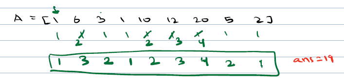
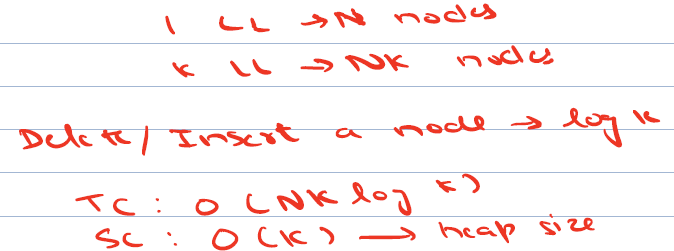
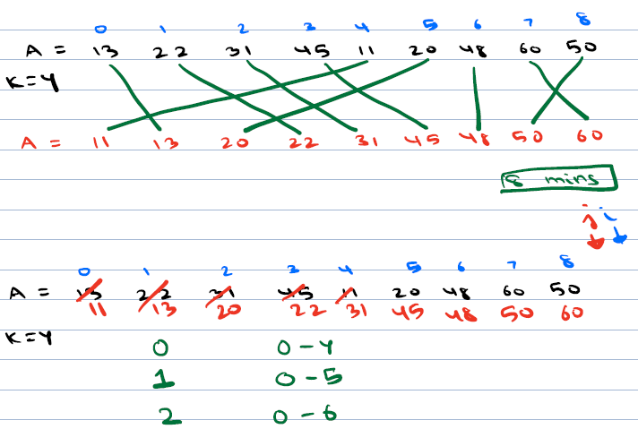
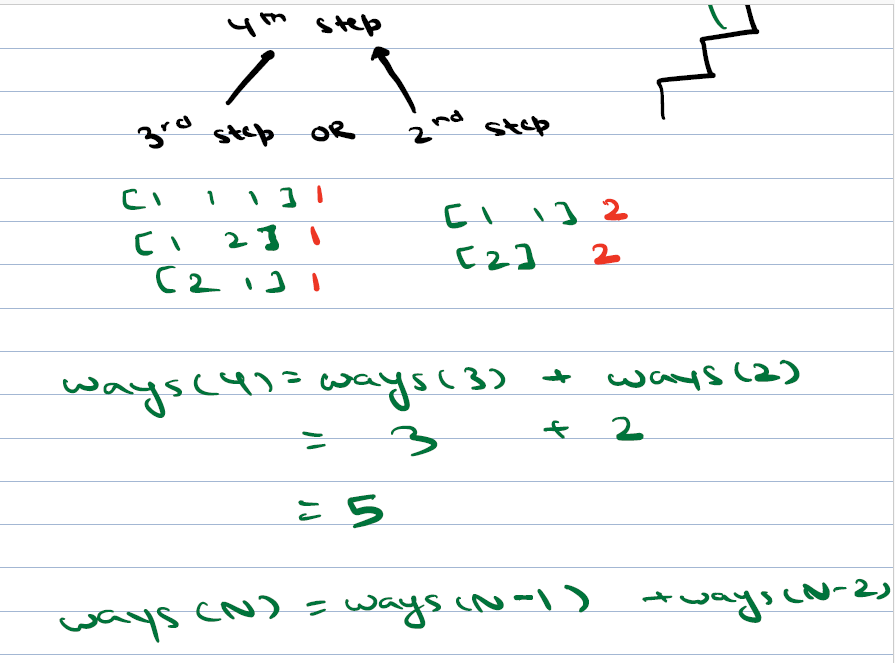
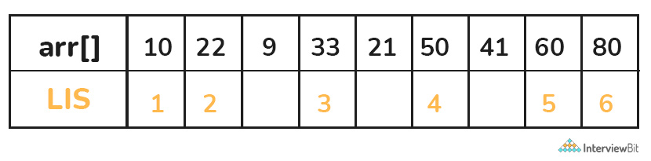
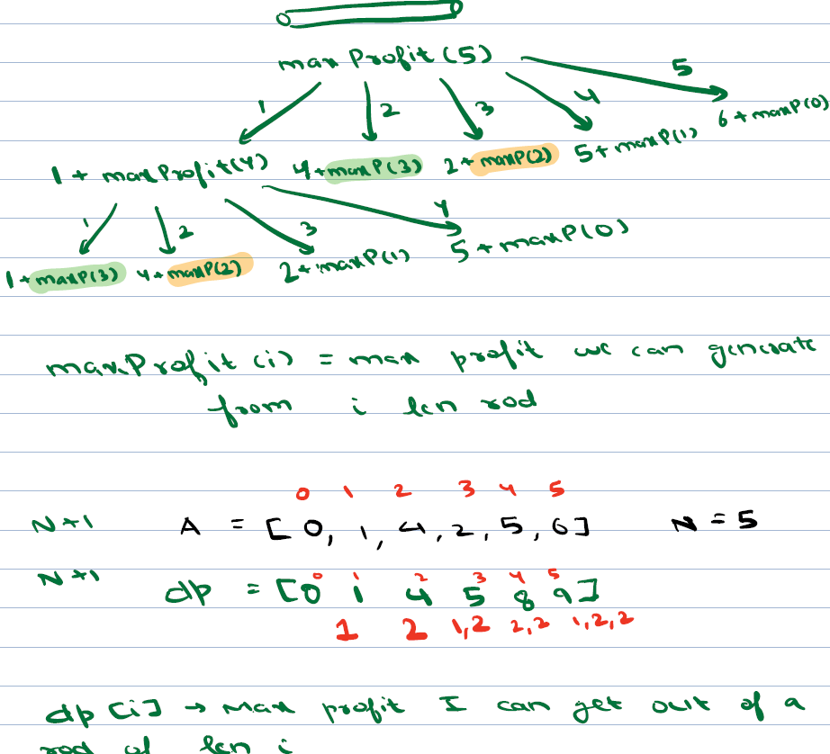
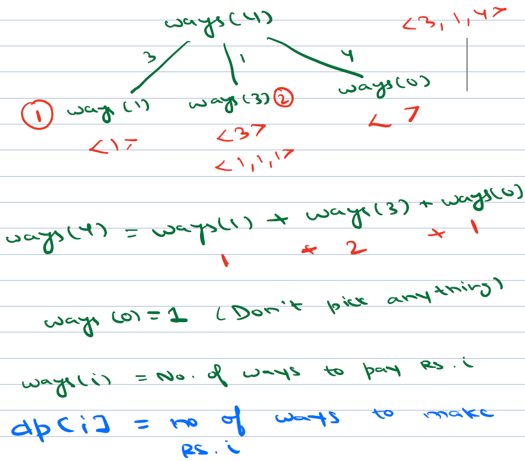

### Heaps

#### Heap queries

You have an empty min heap. You are given an array **A** consisting of **N** queries. Let P denote A[i][0] and Q denote A[i][1]. There are two types of queries:  

P = 1, Q = -1 : Pop the minimum element from the heap.  
P = 2, 1 <= Q <= 109 : Insert Q into the heap.

Return an integer array containing the answer for all the extract min operation. If the size of heap is 0, then extract min should return -1.

##### Using PriorityQueue

```java
public class Solution {
    public int[] solve(int[][] A) {
        PriorityQueue<Integer> minHeap = new PriorityQueue<>();
        ArrayList<Integer> ans = new ArrayList<>();

        for(int i=0; i<A.length; i++) {
            int p = A[i][0];
            int q = A[i][1];
            if(p==1) {
                ans.add(minHeap.isEmpty() ? -1 : minHeap.poll());                
            } else if(p==2) {
                minHeap.add(q);
            }
        }
        // Convert Integer List to primitive int array
        return ans.stream().mapToInt(Integer::intValue).toArray();
    }
}
```

##### Using own implementation of min heap

```java
public class Solution {
    public ArrayList<Integer> solve(ArrayList<ArrayList<Integer>> A) {
        ArrayList<Integer> ans = new ArrayList<Integer>();
        // Maintain heap in array list
        ArrayList<Integer> heapList = new ArrayList<Integer>();
        for(int i=0; i<A.size(); i++) {
            int p = A.get(i).get(0);
            int q = A.get(i).get(1);
            if(p == 1) {
                ans.add(heapList.size()>0 ? extractMin(heapList):-1);
            }  else {
                heapList.add(q);
                // bubbleUp from last node till 0th element
                bubbleUp(heapList);
            }
        }
        return ans;
    }

    private int extractMin(ArrayList<Integer> heapList) {
        int ans = heapList.get(0);
        heapList.set(0, heapList.get(heapList.size()-1));
        heapList.remove(heapList.size()-1);
        // heapify starting at 0th position
        heapify(heapList, 0);
        return ans;
    }
    private void heapify(ArrayList<Integer> heapList, int i) {
        int size = heapList.size();
        // Ensure LC does not exceed array size
        while(2*i+1 < size) {
            int lc = 2*i + 1;
            int rc = 2*i + 2;
            int min = heapList.get(i);

            // Take min of current element, lc and rc
            if(rc < size && heapList.get(rc) < heapList.get(i)) {
                min = heapList.get(rc);
            }
            min = Math.min(min, heapList.get(lc));

            if(min == heapList.get(i)) {
                break;
            } else if(min == heapList.get(lc)) {
                // Swap and go down through LC
                swap(heapList, i, lc);
                i = lc;
            } else {
                // Swap and go down through RC
                swap(heapList, i, rc);
                i = rc;
            }
        }
    }
    private void bubbleUp(ArrayList<Integer> heapList) {
        int i = heapList.size()-1;
        // Do till reaching root
        while(i > 0) {
            int pi = (i-1)/2;
            if(heapList.get(pi) > heapList.get(i)) {
                swap(heapList, i, pi);
                i = pi;
            } else {
                break;
            }
        }
    }
    private void swap(ArrayList<Integer> heapList, int i, int j) {
        int temp = heapList.get(i);
        heapList.set(i, heapList.get(j));
        heapList.set(j, temp);
    }
}
```

#### Connecting Ropes

You are given an array **A** of integers that represent the lengths of ropes.

You need to connect these ropes into one rope. The cost of joining two ropes equals the **sum** of their lengths.

Find and return the **minimum cost** to connect these ropes into one rope.

**Notes:**

* Store the rope length in dynamic array. Create minHeap out of it. Use same array.

* Extract two minElements, add both, add sum to minHeap.

* Repeat until minHeap becomes empty

##### Using PriorityQueue

```java
public class Solution {
    public int solve(int[] A) {
        PriorityQueue<Integer> minHeap = new PriorityQueue<>();
        // if array is having only one element
        if(A.length == 1) return A[0];
        for(int i=0; i<A.length; i++) {
            minHeap.add(A[i]);
        }
        int ans = 0;
        while(minHeap.size() > 1) {
            int firstRope = minHeap.poll();
            int secondRope = minHeap.poll();
            int tempRope = firstRope + secondRope;
            // Add new rope to answer
            ans += tempRope;
            // Add new rope to minHeap
            minHeap.add(tempRope);                       
        }
        // return ans
        return ans;
    }
}
```

##### Using own implementation of minHeap

```java
public class Solution {
    public int solve(ArrayList<Integer> A) {
        buildHeap(A);
        int sum = 0;

        while(A.size() > 1) {
            int first = extractMin(A);
            int second = extractMin(A);            
            int temp = first + second;
            sum += temp;
            A.add(temp);
            bubbleUp(A);
        }                    
        return sum;
    }
    public Integer extractMin(ArrayList<Integer> A) {
        int min = A.get(0);
        int size = A.size();
        A.set(0, A.get(size-1));
        A.remove(size-1);
        heapify(A, 0); 
        return min;
    }

    public void buildHeap(ArrayList<Integer> A) {
        int size = A.size();

        for(int i=(size/2)-1; i>=0; i--) {
            A = heapify(A, i); 
        }
    }

    private ArrayList<Integer> heapify(ArrayList<Integer> A, int i) {

        while((2*i) + 1 < A.size()) {
            int lc = (2*i) + 1;
            int rc = (2*i) + 2;

            int min = Math.min(A.get(lc), A.get(i));

            if(rc < A.size()) {
                min = Math.min(A.get(rc), min);
            }
            if(min == A.get(i)) {
                break;
            } else if(A.get(lc) == min){
                swap(A, i, lc);
                i = lc;
            } else {
                swap(A, i, rc);
                i = rc;
            }
        }
        return A;
    }

    private void bubbleUp(ArrayList<Integer> A) {
        int i=A.size()-1;

        while(i > 0 ) {
            int pi = (i-1)/2;
            if(A.get(pi) > A.get(i)) {
                swap(A, i, pi);
            } else {
                break;
            }
            i = pi;
        }
    }

    private void swap(ArrayList<Integer> A, int a, int b) {
        int temp = A.get(a);
        A.set(a, A.get(b));
        A.set(b, temp);
    }
}
```

#### Find K'th largest element

#### Distribute Candy

N children are standing in a line. Each child is assigned a **rating** value.

You are giving candies to these children subjected to the following requirements:

1. Each child must have at least one candy.
2. Children with a higher rating get more candies than their neighbors.

What is the minimum number of candies you must give?

**Notes:**

- This can be solved using **<u>"Two pass Greedy Approach"</u>**

- Navigate from left to right, compare each element with previous element

- Navigate from right to left, compare each element with next item.

- Add the n-1 element in answer.



```java
public class Solution {
    public int candy(ArrayList<Integer> A) {
        int n = A.size();
        // Initiate ans[] to 1 as at least one candy must be given to each child
        int[] ans = new int[n];
        for(int i=0; i<n; i++) {
            ans[i] = 1;
        }        
        // Navigate from left to right, compare each element with previous element
        for(int i=1; i<n; i++) {
            if(A.get(i) > A.get(i-1)) {
                ans[i] = ans[i-1] + 1;
            }
        }
        int sum = 0;
        // Navigate from right to left, compare each element with next item.
        for(int i=n-2; i>=0; i--) {
            if(A.get(i) > A.get(i+1)) {
                ans[i] = Math.max(ans[i], ans[i+1]+1);
            }
            sum += ans[i];
        }  
        // Add the n-1 element in answer.
        sum += ans[n-1];
        return sum;      
    }
}
```

> TC: $O(n)$
> 
> SC: $O(n)$

#### Merge k sorted Linked List

Given a list containing head pointers of **N** sorted linked lists.  
Merge these given sorted linked lists and return them as one sorted list.

**Notes:**

* Add first element all listNodes in the list into minHeap

* Remove the minNode, add it to ansList and add its next element to minHeap

```java
/**
 * Definition for singly-linked list.
 * class ListNode {
 *     public int val;
 *     public ListNode next;
 *     ListNode(int x) { val = x; next = null; }
 * }
 */
public class Solution {
    public ListNode mergeKLists(ArrayList<ListNode> a) {
        // Define comparator
        PriorityQueue<ListNode> minHeap = new PriorityQueue<>((x,y) -> x.val-y.val);

        // Add first element of all list nodes in the input list into a min heap
        for(int i=0; i<a.size(); i++) {
            minHeap.add(a.get(i));
        }
        ListNode head = new ListNode(-1);
        ListNode temp = head;
        while(minHeap.size() > 0) {
            ListNode minNode = minHeap.poll(); // Remove minNode from minHeap
            head.next = minNode;
            head = head.next;
            // Add next element of current minNode to minHeap
            if(minNode.next != null) {
                minHeap.add(minNode.next);
            }
        }
        return temp.next;
    }
}
```

> TC: $O(nklog(k)$
> 
> n -> number of linked lists
> 
> k -> nodes in each linked list
> 
> For nk elements it will insert/remove for $log(k)$ times
> 
> SC: $O(k)$ -> Heap size
> 
> 

#### Ath largest element

Given an integer array **B** of size **N**.

You need to find the **Ath** largest element in the **subarray [1 to i],** where **i** varies from **1** to **N**. In other words, find the **Ath** largest element in the sub-arrays **[1 : 1], [1 : 2], [1 : 3], ...., [1 : N]**.

**NOTE:** If any subarray [1 : i] has less than A elements, then the output should be **-1** at the **ith** index.

```java
public class Solution {
    public ArrayList<Integer> solve(int A, ArrayList<Integer> B) {

        ArrayList<Integer> ans = new ArrayList<Integer>();
        PriorityQueue<Integer> minHeap = new PriorityQueue<>();
        // Add A-1 element in min heap
        for(int i=0; i<A-1; i++) {
             minHeap.add(B.get(i));
             ans.add(-1);
        }
        // Add Ath element to minHeap ans list
        minHeap.add(B.get(A-1));
        ans.add(minHeap.peek()); 

        // Compare min element with remaining elements in input list and add to ans list accordingly
        for(int i=A; i<B.size(); i++) {
           if(B.get(i) > minHeap.peek()){
               minHeap.remove();
               minHeap.add(B.get(i));
           }
           ans.add(minHeap.peek());           
        }
        return ans;
    }
}
```

#### Flipkart's Inventory

In the recent expansion into grocery delivery, Flipkart faces a crucial challenge in effective inventory management. Each grocery item on the platform carries its own expiration date and profit margin, represented by two arrays, **A** and **B** of size **N.** **A[i]** denotes the time left before expiration date for the **ith** item, and **B[i]** denotes profit margin for the **ith** item. To mitigate potential losses due to expiring items, Flipkart is seeking a strategic solution.  

The objective is to identify a method to strategically buy certain items, ensuring they are sold before their expiration date, thereby maximizing overall profit. Can you assist Flipkart in developing an innovative approach to optimize their grocery inventory and enhance profitability?

Your task is to find the **maximum profit** one can earn by buying groceries considering that you can only buy **one grocery item at a time.**

**NOTE:**

- You can assume that it takes **1** minute to buy a grocery item, so you can only buy the ith grocery item when the **current time <= A[i] - 1.**
- You can start buying from day = 0.
- Return your answer modulo 109 + 7.

##### Using indicesList to sort list A and B

* Create indicesList, store index in it and sort it based on values of list A

* Iterate through incidesList, add profit to sum, minHeap if` expTime < currentTime`.

* if `currentTime == exptime && currentProfit > minElement`, remove minElement from minHeap and Sum and add current Profit to these.

```java
public class Solution {

    public int solve(ArrayList<Integer> A, ArrayList<Integer> B) {

        // Create indices list
        ArrayList<Integer> indicesList = new ArrayList<>();
        for(int i=0; i<A.size(); i++) {
            indicesList.add(i);
        }
        // Sort indicesList as per list-A
        Collections.sort(indicesList, (i, j) -> Integer.compare(A.get(i), A.get(j)));

        // Use priorityQueue to store the profits so far considered
        PriorityQueue<Integer> minHeap = new PriorityQueue<>();
        int sum = 0;
        int time = 0;
        int mod = 1000000007;
        for(int i=0; i<indicesList.size(); i++) {

            int index = indicesList.get(i);
            // Consider profit if the exp time is not exceeded
            if(time < A.get(index)) {
                minHeap.add(B.get(index));
                sum = (sum + B.get(index)) % mod;
                time++;
            }
            // if currenttime == expTime && current element > minElement, remove the min element and add the current element 
            else if(time == A.get(index) && minHeap.peek() < B.get(index)) {
                sum -= minHeap.poll();
                sum = (sum + B.get(index)) % mod;
                minHeap.add(B.get(index));
            }
        }
        return sum;
    }
}
```

> TC: $O(NlogN)$ -> for each element, adding element to minHeap
> 
> SC: $O(N)$ -> heap + indiced list

##### Using Item Class

* Use a separate class to store expTime and profit for each item

```java
public class Solution {
    public class Item {
        int expTime;
        int profit;
        public Item (int expTime, int profit) {
            this.expTime = expTime;
            this.profit = profit;
        }
        public int getExpTime() {
            return this.expTime;
        }
        public int getProfit() {
            return this.profit;
        }
    }
    public int solve(ArrayList<Integer> A, ArrayList<Integer> B) {

        ArrayList<Item> itemList = new ArrayList<>();
        for(int i=0; i<A.size(); i++) {
            itemList.add(new Item(A.get(i), B.get(i)));
        }
        Collections.sort(itemList, (a,b) -> Integer.compare(a.getExpTime(), b.getExpTime()));

        PriorityQueue<Integer> minHeap = new PriorityQueue<>();
        int sum = 0;
        int count = 0;
        int mod = 1000000007;
        for(int i=0; i<itemList.size(); i++) {

            Item item = itemList.get(i);

            if(count < item.getExpTime()) {
                minHeap.add(item.getProfit());
                sum = (sum + item.getProfit()) % mod;
                count++;
            } else if(count == item.getExpTime() && minHeap.peek() < item.getProfit()) {
                sum -= minHeap.poll();
                sum = (sum + item.getProfit()) % mod;
                minHeap.add(item.getProfit());
            }
        }
        return sum;
    }
}
```

#### Interview rooms

You are given an array **B** of meeting **time intervals** where each interval is represented as **[start, end]** (with start < end). You need to find the **minimum** number of conference rooms required to host all the meetings.

**Notes:**

* Sort the interval list based on start time

* Keep the end time of ongoing meetings in a minHeap.

* Compare each meeting start time with the minElement. If startTime >= minElement, reuse the existing room, if not use a new room.

```java
public class Solution {
    public int solve(int A, ArrayList<ArrayList<Integer>> B) {

        int count = 1; // Initialize count=1

        // Sort based on the start time
        Collections.sort(B, (x,y) -> Integer.compare(x.get(0), y.get(0)));
        // minHeap to maintain the end times
        PriorityQueue<Integer> minHeap = new PriorityQueue<>();
        // Add end time to minHeap
        minHeap.add(B.get(0).get(1));

        for(int i=1; i<B.size(); i++) {
            //Compare start time of each element with end time in minHeap
            if(B.get(i).get(0) >= minHeap.peek()) {
                minHeap.poll(); // Remove this minElement. This room is occupied with new interview.                
            } else {
                count++; // Use new room
            }
            minHeap.add(B.get(i).get(1)); // Add the meeting to minHeap            
        }
        return count;
    }
}
```

> TC: $O(nlog(n))$
> 
> SC: $O(n)$

#### K places apart

https://www.scaler.com/academy/mentee-dashboard/class/523622/assignment/problems/9264?navref=cl_tt_lst_nm

**N** people having different priorities are standing in a queue.

The queue follows the **property** that each person is standing at most **B** places away from its position in the sorted queue.

Your **task** is to sort the queue in the increasing order of priorities.

**NOTE:**

- No two persons can have the same priority.
- Use the property of the queue to sort the queue with complexity O(NlogB).

**Notes:**

* This is called as **<u>Nearly sorted Array or K sorted array</u>** problem

* Use minHeap to store the elements

* First store B elements in minHeap

* extract minElement, add to ansList

* And continue adding remaining elements into minHeap

* At the end, what ever elements are remaining in minHeap, add it to ansList



* ```java
  public class Solution {
    public ArrayList<Integer> solve(ArrayList<Integer> A, int B) {
        int n = A.size();
        PriorityQueue<Integer> minHeap = new PriorityQueue<>();
        // Add elements till B index
        for(int i=0; i<=B; i++) {
            minHeap.add(A.get(i));
        }
        // Remove minElement and add to ansList
        // A.set(0, minHeap.poll());
        int j = 1;
        for(int i=B+1; i<n; i++) {
            minHeap.add(A.get(i));
            A.set(j, minHeap.poll());
            j++;
        }
        while(!minHeap.isEmpty()) {
            A.set(j, minHeap.poll());
            j++;
        }
        return A;
    }
  }
  ```

> TC: $O((n+B)logB)$
> 
> SC: $O(B)$ -> at any point of time, only B elements are in minHeap

#### Shaggy and distances

Shaggy has an array **A** consisting of N elements. We call a pair of distinct indices in that array a special if elements at those indices in the array are equal.

Shaggy wants you to find a special pair such that the distance between that pair is minimum. Distance between two indices is defined as |i-j|. If there is no special pair in the array, then return -1.

**Notes:**

* Use hashmap to store and maintain the element and its position

```java
public class Solution {
    public int solve(ArrayList<Integer> A) {
        int n = A.size();
        // Initialize to n
        int ans = n;
        // key = element, value=position
        HashMap<Integer,Integer> hm = new HashMap<>();
        for(int i=0; i<n; i++) {
            if(hm.containsKey(A.get(i))) {
                // Min of ans and latest pos-previous position of current element
                ans = Math.min(ans, i - hm.get(A.get(i)));
            }
            // Put latest position in hm
            hm.put(A.get(i), i);
        }
        // if ans=n, no such pair is found
        return ans == n ? -1 : ans;
    }
}
```

#### Minimum Window Substring -> HARD

Given two strings A and B of lengths m and n respectively, return the minimum window substring of A such that every character in B (including duplicates) is included in the window. If there is no such substring, return "-1".  

When there are multiple answers, return the one which appears first in A.

**Notes:**

* Use two arrays to maintain count of chars in String A and B.

* Calculate count of chars of B at the beginning itself

* Slide through the String A from index 0

* When ever match is found, remove the char at the beginning of substring.

* when match is found and substring is shorter, store the start and end indexes

* If `endIndex != -1`, some match was found, retun the substring

```java
public class Solution {
    public String minWindow(String A, String B) {
        // Split String to charArray
        char[] charArrayA = A.toCharArray();
        char[] charArrayB = B.toCharArray();
        // freqArray will have max 123 chars
        int[] freqA = new int[123];
        int[] freqB = new int[123];        

        // Count freqB completely
        for(int i=0; i<charArrayB.length; i++) {
            freqB[charArrayB[i]]++;
        }
        int j=0;
        int start=0;
        int end=-1;
        // Keep min to length+1
        int min = A.length()+1;
        for(int i=0; i<charArrayA.length; i++) {
            // Increment the count of char at i
            freqA[charArrayA[i]]++;
            // checkCount until it becomes false
            while(checkCount(freqA, freqB, B)) {
                // Check if the new substring is shorter
                if(i-j+1 < min) {
                    min = i-j+1;                                                       
                    start = j;
                    end = i;
                }
                // Remove the char at beginning, as substring is found
                freqA[charArrayA[j]]--;
                j++;
            }
        }
        // if end == -1, then no match was found
        return end != -1 ? A.substring(start, end+1) : "-1";
    }

    private boolean checkCount(int[] freqA, int[] freqB, String B) {
        for(char ch:B.toCharArray()) {
            // if B has char and the count is > count in A, return false immediately
            if(freqB[ch]>0 && freqA[ch]<freqB[ch]) {
                return false;
            }
        }
        return true;
    }
}
```

> TC: $O(N+M)$
> 
> SC: $O(1)$

### Dynamic Programming

#### Fibonacci Number

```java
public class Main {
    public static void main(String[] args) {
        // YOUR CODE GOES HERE
        // Please take input and print output to standard input/output (stdin/stdout)
        // DO NOT USE ARGUMENTS FOR INPUTS
        // E.g. 'Scanner' for input & 'System.out' for output

        Scanner sc = new Scanner(System.in);
        int n = sc.nextInt();

        int a = 0;
        int b = 1;
        int ans = 0;
        for(int i=1; i<n; i++) {
            ans = a+b;
            a = b;
            b = ans;
        }
        System.out.println(b);
    }
}
```

#### Minimum Number of Squares

**Problem Description**  

Given an integer **A**. Return **minimum** count of numbers, sum of whose **squares** is equal to **A**.

```java
public class Solution {
    public int countMinSquares(int A) {
        int dp[] = new int[A+1];
        for(int i=0; i<=A; i++) {
            dp[i] = -1;
        }
        return minSquares(A, dp);
    }
    private int minSquares(int A, int[] dp) {

        if(A == 0) return 0;
        if(dp[A] != -1) return dp[A];
        int min = Integer.MAX_VALUE;

        for(int i=1; i*i<=A; i++) {
            min = Math.min(min, minSquares(A-i*i, dp));
        }
        dp[A] = min + 1;
        return min+1;
    }
}
```

TC: $nMath.sqrt(n)$

SC: $O(n)$

#### Stairs

**Problem Description**  

You are climbing a staircase and it takes **A** steps to reach the top.

Each time you can either climb **1** or **2** steps. In how many **distinct ways** can you climb to the top?

Return the number of distinct ways modulo 1000000007



> :bulb: This follows **Fibonacci series exactly**

```java
public class Solution {
    public int climbStairs(int A) {

        int ans = 0;
        int a = 0;
        int b = 1;
        if(A == 0 || A == 1) {
            return A;
        }
        for(int i=1; i<=A; i++) {
            ans = a + b;
            a = b;
            b = ans%1000000007;
        }
        return ans%1000000007;
    }
}
```

#### Longest Increasing Subsequence

**Problem Statement**

The Longest Increasing Subsequence (LIS) problem is to find the length of the longest subsequence of a given sequence such that all elements of the subsequence are sorted in increasing order.

**Example Input:**

{10, 22, 9, 33, 21, 50, 41, 60, 80} 

Output: 6 

**Explanation:**



● Element of choice: At each index i in the array, we have a choice to either include or exclude the current element nums[i] in the increasing subsequence.

● State representation: We can represent the state as dp[i], which stores the length of the longest increasing subsequence ending at index i.

● Recurrence relation: To calculate dp[i], we iterate over all previous elements j (from 0 to i-1), and if nums[i] > nums[j], we update dp[i] as max(dp[i], dp[j] + 1). This means the length of the LIS ending at index i is either the length already stored in dp[i] or the length of the LIS ending at index j plus one. 

● Final answer: The final answer for the solution will be the maximum value in the dp array.

```context
function lengthOfLIS(nums) {
    n = length(nums)

    if n == 0
        return 0

    dp = array of size n, initialized with all 1s

    for i = 1 to n-1 {
        for j = 0 to i-1 {
            if nums[i] > nums[j]
                dp[i] = max(dp[i], dp[j] + 1)
        }
    }

    max_length = maximum value in dp array

    return max_length
}
```

#### Knapsack

##### Cutting a Rod

Given a rod of length **N** units and an array **A** of size N denotes prices that contains prices of all pieces of size **1 to N**.

Find and return the **maximum** value that can be obtained by cutting up the rod and selling the pieces.

Notes:

* This follows **<u>UNBOUNDED KNAPSACK.</u>**



```java
public class Solution {
    public int solve(int[] A) {
        int N = A.length;
        int[] dp = new int[N+1];

         for(int i=1; i<=N; i++) {
            for(int cut=1; cut<=i; cut++) {
                dp[i] = Math.max(dp[i], A[cut-1] + dp[i-cut]);
            }
        }
        return dp[N];        
    }
}
```

> TC: $O(Npow2)$
> 
> SC: $O(N)$

##### Coin Sum Infinite Knapsack - Combination

https://www.scaler.com/academy/mentee-dashboard/class/523631/assignment/problems/319/?navref=cl_pb_nv_tb

You are given a set of coins **A**. In how many ways can you make sum **B** assuming you have infinite amount of each coin in the set.

**NOTE:**

- Coins in set A will be unique. Expected space complexity of this problem is **O(B)**.
- The answer can overflow. So, return the answer % (106 + 7).

**Notes:**

* The problem is asking for **the unique ways, so its Combinations**, where order is not considered. In **Permutations** order is considered.

* **Permutation vs Combination**
  
  | Loop order       | Counts           |
  | ---------------- | ---------------- |
  | `amount → coins` | **Permutations** |
  | `coins → amount` | **Combinations** |

* So, First iterate through the coins list. Ask is for Combinations where Order is not considered.

* Outer loop must be on Coins, Inner loop must be on Amount.



```java
public class Solution {
    public int coinchange2(int[] A, int B) {
        int[] dp = new int[B+1];
        int mod = 1000007;
        // 0 amount can be selected in 1 way
        dp[0] = 1;

        // Iterate through the coins list. Ask is for Combinations where Order is not considered.
        // Same coins cant be used again with diff order.
        for(int i=0; i < A.length; i++) {
            // Iterate through each coin amount until B
            for(int j=1; j <= B; j++) {
                if(A[i] <= j) {
                    dp[j] = (dp[j] + dp[j-A[i]])%mod;
                }
            }
        }
        return dp[B]%mod;
    }
}
```

> TC: $O(NB)$
> 
> SC: $O(B)$

##### Coin Sum Infinite Knapsack - Permutation

**Notes:**

- The problem is asking for the Permutations  where order matters. That means it can contain same set of coins but in different order

- **Permutation vs Combination**
  
  | Loop order       | Counts           |
  | ---------------- | ---------------- |
  | `amount → coins` | **Permutations** |
  | `coins → amount` | **Combinations** |

- So, First iterate through the coins list. Ask is for Combinations where Order is not considered

- Outer loop must be on Amount, Inner loop must be on Coins.

```java
public class Solution {
    public int coinchange2(int[] A, int B) {
        int[] dp = new int[B+1];
        int mod = 1000007;
        // 0 coins can be selected in 1 way
        dp[0] = 1;

        // Iterate through the amount first. Ask is for permutations where Order matters.
        // Same set of coins can be used again with diff order
        for(int i=1; i <= B; i++) {
            // Iterate through each coin amount until B
            for(int j=0; j <= A.length; j++) {
                if(A[j] <= i) {
                    dp[i] = (dp[i] + dp[i-A[j]])%mod;
                }
            }
        }
        return dp[B]%mod;
    }
}
```

##### Bob and Chocolates

**Problem Description**  

You are in a chocolate shop that sells **N** number of different chocolates. You are given that the price of each chocolate is **B[i]** and the sweetness of each chocolate is **C[i]**.  

You have decided that the total price of your purchases will be **atmost A**. You can buy each chocolate at most once. What is the *maximum* sweetness we can get using **atmost A** rupees?  
*Please read the examples given below carefully to better understand the problem*

**Problem Constraints**  

1 <= N <= 103  

1 <= A <= 2000  

1 <= B[i] <= 103  

1 <= C[i] <= 103

```java
public class Solution {
    public int solve(int A, int[] B, int[] C) {
        int n = B.length;
        int[][] dp = new int[n+1][A+1];

        Arrays.setAll(dp, row -> {
            int[] temp = new int[A+1];
            Arrays.fill(temp, -1);
            return temp;
        });
        for(int i=0; i<A+1; i++) {
            dp[0][i] = 0;
        }
        for(int i=0; i<n+1; i++) {
            dp[i][0] = 0;
        }

        for(int i=1; i<=n; i++) {
            for(int j=1; j<=A; j++) {

                if(j >= B[i-1]) {
                    int incl = dp[i-1][j-B[i-1]]+C[i-1];
                    int excl = dp[i-1][j];
                    dp[i][j] = Math.max(incl, excl);
                } else {
                    dp[i][j] = dp[i-1][j];
                }               
            }
        }
        return dp[n][A];
    }
}
```

### MST/Prims algorithm

#### Commutable Islands

**Problem Description**  

There are **A** islands and there are **M** bridges connecting them. Each bridge has some **cost** attached to it.

We need to find bridges with **minimal cost** such that all islands are connected.

It is guaranteed that input data will contain **at least one** possible scenario in which all islands are connected with each other.

```java
public class Solution {
    public int solve(int A, int[][] B) {

        ArrayList<ArrayList<Integer>>[] adjacencyMatrix = new ArrayList[A+1];

        // Initialize matrix beforehand
        for(int i=1; i<adjacencyMatrix.length; i++) {
            adjacencyMatrix[i] = new ArrayList<ArrayList<Integer>>();
        }
        constructAdjacencyMatrix(A, B, adjacencyMatrix);
        boolean[] visited = new boolean[A+1];
        return findMinCost(A, B, adjacencyMatrix, visited);
    }

    private int findMinCost(int A, int[][] B, ArrayList<ArrayList<Integer>>[] adjacencyMatrix, boolean[] visited) {

        // Add comparator logic to minHeap. It is list<Integer>
        PriorityQueue<ArrayList<Integer>> minHeap = new PriorityQueue<>((a,b) -> Integer.compare(a.get(0), b.get(0)));

        // Read the 1st vetrice to start with and add all child vetrix
        if(adjacencyMatrix[1] != null) {
            for(int i=0; i<adjacencyMatrix[1].size(); i++) {
                minHeap.add(adjacencyMatrix[1].get(i));
            }
            visited[1] = true;
        }

        int ans=0;

        while(!minHeap.isEmpty()) {
            ArrayList<Integer> currentNodeData = minHeap.poll();

            int cost = currentNodeData.get(0);
            int currentNode = currentNodeData.get(1);

            // Dont read this node if it is already visited
            if(visited[currentNode] == true) {
                continue;
            }

            // add cost to answer and make it visited
            ans += cost;
            visited[currentNode] = true;

            // Add all child nodes into minHeap
            for(int i=0; i<adjacencyMatrix[currentNode].size(); i++) {
                ArrayList<Integer> childNodeData = adjacencyMatrix[currentNode].get(i);
                int childNodeCost = childNodeData.get(0);
                int childNode = childNodeData.get(1);
                if(visited[childNode] == false) {
                    minHeap.add(new ArrayList<>(Arrays.asList(childNodeCost, childNode)));
                }
            }
        }
        // Ideally this for loop is not required, as problem says all vertices are connected
        for(int i=1; i<visited.length; i++) {
            if(visited[i] == false) return -1;
        } 
        return ans;        
    }

    private void constructAdjacencyMatrix(int A, int[][] B, ArrayList<ArrayList<Integer>>[] adjacencyMatrix) {
        for(int i=0; i<B.length; i++) {
            int fromNode = B[i][0];
            int toNode = B[i][1];
            int cost = B[i][2];
            // as it is undirected graph add both directions
            adjacencyMatrix[fromNode].add(new ArrayList<>(Arrays.asList(cost, toNode)));
            adjacencyMatrix[toNode].add(new ArrayList<>(Arrays.asList(cost, fromNode)));
        }
    }
}
```

>  TC: $O(ElogE + 2E) => O(ElogE)$
> 
> SC: $O(V + E)$ V -> visited[], E -> Stack size

### DFS

#### Possibility of Finishing a Course

**Problem Description**  

There are a total of **A** courses you have to take, labeled from **1** to **A**.

Some courses may have prerequisites, for example to take course **2** you have to first take course **1**, which is expressed as a pair: **[1,2]**.

So you are given two integer array **B** and **C** of same size where for each i **(B[i], C[i])** denotes a pair.

Given the total number of courses and a list of prerequisite pairs, is it possible for you to finish all courses?

Return **1** if it is **possible** to finish all the courses, or **0** if it is **not possible** to finish all the courses.

**Notes**

* Find if there is a cycle. if there is, it is not possible to complete all courses

```java
public class Solution {
    public int solve(int A, int[] B, int[] C) {

        // Create adjacencyMatrix
        ArrayList<Integer>[] adjacencyArray = new ArrayList[A+1];
        for(int i=1; i<=A; i++) {
            adjacencyArray[i] = new ArrayList<>();
        }
        for(int i=0; i<B.length; i++) {
            adjacencyArray[B[i]].add(C[i]);
        }
        boolean[] visited = new boolean[A+1];
        boolean[] path = new boolean[A+1];

        int ans = -1;
        // Do dfs on all nodes
        for(int i=1; i<=A; i++) {
            // Do dfs only if its not visited
            if(visited[i] == false) {
                ans = dfs(i, adjacencyArray, visited, path);
                if(ans == 0) return ans;
            }            
        }
        return 1;
    }

    private int dfs(int node, ArrayList<Integer>[] adjacencyArray, boolean[] visited, boolean[] path) {

        path[node] = true;
        visited[node] = true;

        if(adjacencyArray[node] != null) {
            // Iterate through all child nodes
            for(int i=0; i<adjacencyArray[node].size(); i++) {
                int childNode = adjacencyArray[node].get(i);
                // Skip if the node is already visited
                if(visited[childNode] == true) {
                    // If childNode is in path, it is a cycle
                    if(path[childNode] == true) {                        
                        return 0;
                    }
                } else {  
                    // Do dfs on childNode as it is not yet visited              
                    if(dfs(childNode, adjacencyArray, visited, path) == 0) {
                        // Immediately return 0 to stop further recursion
                        return 0;
                    }
                }
            }
        }
        // Make the path as false as we are coming back on the same path
        path[node] = false;
        return 1;        
    }
}
```

> TC: $O(V+E)$
> 
> SC: $O(V)$

#### Shortest distance in a Maze

https://www.scaler.com/academy/mentee-dashboard/class/523645/assignment/problems/4697/submissions

**Problem Description**  

Given a matrix of integers A of size **N** x **M** describing a maze. The maze consists of empty locations and walls.

1 represents a wall in a matrix and 0 represents an empty location in a wall.

There is a ball trapped in a maze. The ball can go through empty spaces by rolling up, down, left or right, but it won't stop rolling until hitting a wall (maze boundary is also considered as a wall). When the ball stops, it could choose the next direction.

Given two array of integers of size B and C of size 2 denoting the starting and destination position of the ball.

Find the shortest distance for the ball to stop at the destination. The distance is defined by the number of empty spaces traveled by the ball from the starting position (excluded) to the destination (included). If the ball cannot stop at the destination, return -1.

**Problem Constraints**  

2 <= **N**, **M** <= 100

0 <= A[i] <= 1

0 <= B[i][0], C[i][0] < N

0 <= B[i][1], C[i][1] < M

```java
public class Solution {
    public int solve(int[][] A, int[] B, int[] C) {
        int N = A.length;
        int M = A[0].length;
        int[] rows = new int[]{-1,0,1,0};
        int[] cols = new int[]{0,1,0,-1};
        int[][] dist = new int[N][M];
        // Store array in Queue - In the order -> X, Y, distance
        Queue<int[]> queue = new LinkedList<>();

        for(int[] rows1:dist) {
            Arrays.fill(rows1, Integer.MAX_VALUE);
        }
        // Sotre source cell with distance as 0
        queue.add(new int[]{B[0], B[1], 0});
        // Distance of source cell is 0
        dist[B[0]][B[1]] = 0;

        while(!queue.isEmpty()) {
            int[] curNode = queue.poll();
            int curX = curNode[0];
            int curY = curNode[1];
            int storedDistance = curNode[2];

            for(int i=0; i<4; i++) {
                // Dont count the source cell
                int currDistance =-1;                
                int tempX = curX;
                int tempY = curY;
                // Navigate in the same direction until block encountered
                while(tempX >=0 && tempX<N && tempY>=0 && tempY<M && A[tempX][tempY] == 0) {
                    tempX = tempX + rows[i];
                    tempY = tempY + cols[i];
                    currDistance++;
                }
                // Go back to previous cell which is valid cell
                tempX -= rows[i];
                tempY -= cols[i];

                int newDistance = storedDistance+currDistance;
                // Compare with current distance
                if(newDistance < dist[tempX][tempY]) {
                    dist[tempX][tempY] = newDistance;
                    queue.add(new int[]{tempX, tempY, newDistance});
                }
            }
        }

        return dist[C[0]][C[1]] != Integer.MAX_VALUE ? dist[C[0]][C[1]] : -1;
    }
}
```

> TC: $O(N*M* (N+M))$
> 
> SC: $O(N*M)$

#### Number of Islands

https://www.scaler.com/academy/mentee-dashboard/class/523645/assignment/problems/4702/?navref=cl_pb_nv_tb

**Problem Description**  

Given a matrix of integers **A** of size **N x M** consisting of **0** and **1**. A group of connected **1's** forms an island. From a cell **(i, j)** such that **A[i][j] = 1** you can visit any cell that shares a corner with (i, j) and value in that cell is 1.

More formally, from any cell (i, j) if A[i][j] = 1 you can visit:

- **(i-1, j)** if (i-1, j) is inside the matrix and A[i-1][j] = 1.
- **(i, j-1)** if (i, j-1) is inside the matrix and A[i][j-1] = 1.
- **(i+1, j)** if (i+1, j) is inside the matrix and A[i+1][j] = 1.
- **(i, j+1)** if (i, j+1) is inside the matrix and A[i][j+1] = 1.
- **(i-1, j-1)** if (i-1, j-1) is inside the matrix and A[i-1][j-1] = 1.
- **(i+1, j+1)** if (i+1, j+1) is inside the matrix and A[i+1][j+1] = 1.
- **(i-1, j+1)** if (i-1, j+1) is inside the matrix and A[i-1][j+1] = 1.
- **(i+1, j-1)** if (i+1, j-1) is inside the matrix and A[i+1][j-1] = 1.

Return the number of islands.

**NOTE:** Rows are numbered from top to bottom and columns are numbered from left to right.

**Problem Constraints**  

1 <= N, M <= 100

0 <= A[i] <= 1

**Notes:**

* Use DFS to identify the connected lands

* Use 8 co-ordinates to go in all directions including diagonols

```java
public class Solution {
    public int solve(int[][] A) {

        int count =0;
        for(int i=0; i<A.length; i++) {
            for(int j=0; j<A[0].length; j++) {
                // Do DFS only if it is unvisited land
                if(A[i][j] == 1) {
                    // Increment counter, as this indicates it is new land
                    count++;
                    dfs(A, i, j);                    
                }
            }
        }
        return count;
    }

    void dfs(int[][] A, int i, int j) {
        // Make it a visited land
        A[i][j] = 2;
        // Cover diagonols too
        int[] rows = new int[]{-1,-1,0,1,1,1,0,-1};
        int[] cols = new int[]{0,1,1,1,0,-1,-1,-1};
        // Loop for 8 times
        for(int k=0; k<8; k++) {
            int curX = i+rows[k];
            int curY = j+cols[k];
            if(curX>=0 && curX<A.length && curY>=0 && curY<A[0].length && A[curX][curY] == 1) {
                // Do DFS in for all cells
                dfs(A, curX, curY);
            }
        }
    }
}
```

> TC: $O(N*M+4*N*M) => O(N*M)$
> 
> SC: $O(N*M)$ => Stack space => If all are land cells

#### Jump game

**Problem Description**  

You are given an array of non-negative integers **A**, where each element in the array represents the **maximum number of steps** you can jump forward from that position.  

A **jump** means moving from the **current index** to another index further in the array **within the allowed range of steps** defined by the value at the current index. For instance, if A[i] = 3, you can jump to any of the next 3 positions from index i (i.e., **i+1, i+2, or i+3**), provided these positions are within the bounds of the array.  

Your task is to determine the **minimum** number of jumps required to reach the last index of the array, starting from the first index.  

If it's not possible to reach the last index, return **-1**.

**Notes:**

Use **<u>Greedy approach</u>** to find the min jumps required to reach the end

- `farthest`: the farthest index reachable from all positions explored so far.

- `currentEnd`: the end of the range reachable using the current number of jumps.

- `jumps`: the minimum jumps counted so far.

```java
public class Solution {
    public int solve(int[] A) {
        int N = A.length;
        if(N==1) return 0; // We are already at the end

        int farthest =0;
        int currEnd = 0;
        int jumps =0;

        for(int i=0; i<N; i++) {
            farthest = Math.max(farthest, i+A[i]);

            if(currEnd == i) {
                jumps++; //we reached the currentEnd index, increment the jump count
                if(farthest >= N-1) break; // We have reached the end or exceeded end
                currEnd = farthest; // Update the currentEnd               
            }
            // We can't move further
            if(farthest <= i) {
                return -1;
            }
        }
        return jumps;        
    }
}
```

> TC: $O(N)$
> 
> SC: $O(1)$

Below code takes $O(N^2)$ TC. This does not use the farthest, currentEnd indexes.

```java
public class Solution {
    public int solve(int[] A) {
        int N = A.length;
        if(N==1) return 0;
        else if(A[0]==0) return -1;
        int count[] = new int[N];
        // Initialize array with MAX_VALUE
        Arrays.fill(count, Integer.MAX_VALUE);
        count[0] = 0;
        for(int i=1; i<N; i++) {
            for(int j=0;j<i;j++) {
                // From each j position, find if its possible to cross i
                if(count[j] != Integer.MAX_VALUE && j+A[j] >= i) {
                    // Find the min steps required to reach i
                    count[i] = Math.min(count[i], count[j]+1);
                }
            }
        }
        return count[N-1] != Integer.MAX_VALUE ? count[N-1] : -1;
    }
}
```

Below code is with $O(N)$ Time Complexity. This code is submitted successfully, how ever some edge test cases seem to fail.

```java
public class Solution {
    public int solve(int[] A) {
        int N = A.length;
        for(int i=1;i<N;i++) {
            A[i] = Math.max(A[i-1], i+A[i]);
        }
        int jumps=0;
        int curIndex = 0;
        while(curIndex<N-1) {
            jumps++;
            if(A[curIndex] == curIndex) {
                return -1;
            }
            curIndex = A[curIndex];       
        }
        return jumps;
    }
}
```

#### Best Time to Buy and Sell Stocks II

https://www.scaler.com/academy/mentee-dashboard/class/523645/assignment/problems/11?navref=cl_tt_lst_nm

**Problem Description**  

Say you have an array, **A**, for which the **ith** element is the price of a given stock on day **i**.

Design an algorithm to find the maximum profit.

You may complete as many transactions as you like (i.e., buy one and sell one share of the stock multiple times).

However, you may not engage in multiple transactions at the same time (ie, you must sell the stock before you buy again).

**Algorithm:**

Greedy algorithm - at every step, you make the locally optimal choice (grab profit whenever price increases) without worrying about the overall strategy, and that ends up giving the global optimum.

```java
public class Solution {
    // DO NOT MODIFY THE LIST. IT IS READ ONLY
    public int maxProfit(final List<Integer> A) {
        int profit = 0;
        for(int i=0; i<A.size()-1; i++) {
            if(A.get(i) < A.get(i+1)) {
                profit += A.get(i+1)-A.get(i);
            }
        }
        return profit;
    }
}
```

### Contest 1 Problems

#### Magical Bridge

**Problem Description**  

In the mysterious village of Two Rivers you found a Magical Bridge, the bridge road is made up of **N** wooden planks numbered form 1 to N.  
As you are a normal human being in one step you can move forward only one plank, but the bridge is magical so it gives you some special powers.  
The power is as follows, if you are at some plank **i** then you can also move **Ai** plank(s) in one step.  
Also the village was mysterious so some monsters are chasing you and you want to cross the bridge in minimum number of steps.  
Find the minimum number of steps to cross the bridge.  

Note: Moving backward isn't an option.

```java
public class Solution {
    public int solve(int[] A) {
        int n = A.length;
        int[] dp = new int[n];
        dp[n-1] = 1;

        for(int i=n-2; i>=0; i--) {
            int a = dp[i+1];
            int b = i+A[i] >= n ? 0: dp[i+A[i]];
            dp[i] = Math.min(a,b) + 1;
        }
        return dp[0];
    }
}
```

#### Bob and Chocolates

**Problem Description**  

You are in a chocolate shop that sells **N** number of different chocolates. You are given that the price of each chocolate is **B[i]** and the sweetness of each chocolate is **C[i]**.  

You have decided that the total price of your purchases will be **atmost A**. You can buy each chocolate at most once. What is the *maximum* sweetness we can get using **atmost A** rupees?  
*Please read the examples given below carefully to better understand the problem*

**Problem Constraints**  

1 <= N <= 103  

1 <= A <= 2000  

1 <= B[i] <= 103  

1 <= C[i] <= 103

```java
public class Solution {
    public int solve(int A, int[] B, int[] C) {
        int n = B.length;
        int[][] dp = new int[n+1][A+1];

        Arrays.setAll(dp, row -> {
            int[] temp = new int[A+1];
            Arrays.fill(temp, -1);
            return temp;
        });
        for(int i=0; i<A+1; i++) {
            dp[0][i] = 0;
        }
        for(int i=0; i<n+1; i++) {
            dp[i][0] = 0;
        }

        for(int i=1; i<=n; i++) {
            for(int j=1; j<=A; j++) {

                if(j >= B[i-1]) {
                    int incl = dp[i-1][j-B[i-1]]+C[i-1];
                    int excl = dp[i-1][j];
                    dp[i][j] = Math.max(incl, excl);
                } else {
                    dp[i][j] = dp[i-1][j];
                }               
            }
        }
        return dp[n][A];
    }
}
```

#### Strengthen It (Graph)

**Problem Description**  

You are given an undirected graph with **A** nodes and **|B|** edges, where the **ith** edge connects nodes B[i][0] and B[i][1].  

The strength of a connected component is defined as the number of edges in that component.  

Additionally, you are given an integer **C**, representing the number of edges you are allowed to add to the graph.  

Your task is to determine the **maximum strength** that any connected component in the graph can achieve after adding **at most C edges**.

**Note:**

- Edges (i, j) and (j, i) are considered identical edges. Adding such duplicate edges is not allowed.
- Self-loops (edges of the form (i, i)) are not allowed.

**Problem Constraints**  

1 <= **A** <= 104

1 <= **|B|** <= (A * (A - 1) / 2)

1 <= **B[i][0], B[i][1]** <= **A**

0 <= **C** <= 109

```java
public class Solution {
    public int solve(int A, int[][] B, int C) {

        ArrayList<Integer>[] graph = new ArrayList[A+1];
        for(int i=0; i<graph.length; i++) {
            graph[i] = new ArrayList<>();
        }
        buildGraph(B, graph);

        boolean[] visited = new boolean[A+1];
        // Keep connected nodes in list
        List<Integer> connectedNodes = new ArrayList<>();

        // Keep strength of each graph in a list
        List<Integer> strengths = new ArrayList<>();

        for(int i=1; i<=A; i++) {
            if(visited[i] == false) {
                connectedNodes.clear(); // Clear the connectedNode before each DFS, as its a different unconnected graph
                dfs(graph, i, B, visited, connectedNodes);

                int nodeCount = 0;
                for(int node:connectedNodes) {
                    nodeCount += graph[node].size(); // Find the total number of nodes in undirected graph
                }
                int edgeCount = nodeCount/2; // Edge=nodes/2
                strengths.add(edgeCount); // Strength is equal to Edge Count as per problem statement
            }            
        }

        Collections.sort(strengths, Collections.reverseOrder()); // Sort in desc order

        int i=1;
        int maxStrength = strengths.get(0); // Start with the first element

        while(i<strengths.size() && C>0) {
            maxStrength += strengths.get(i);
            maxStrength++; // The extra node being added
            C--;
            i++;
        }
        maxStrength += C; // Add the remaining edges from C
        maxStrength = Math.min(maxStrength, A*(A-1)/2); // Some times C may be too high, So nodes will be connected
        return maxStrength;
    }

    void dfs(List<Integer>[] graph, int i, int[][] B, boolean[] visited, List<Integer> connectedNodes) {

        if(visited[i] == true) {
            return;
        }

        visited[i] = true;
        connectedNodes.add(i); // Accumulate the connected nodes in this list

        if(graph[i].size() > 0) {
            for(int childNode:graph[i]) {
                if(visited[childNode] == false) {
                    dfs(graph, childNode, B, visited, connectedNodes);
                }
            }
        }
    }

    void buildGraph(int[][] B, List<Integer>[] graph) {        
        for(int i=0; i<B.length; i++) {
            int fromNode = B[i][0];
            int toNode = B[i][1];
            graph[fromNode].add(toNode);
            graph[toNode].add(fromNode);
        }
    }
}
```

#### Minimum Number of Squares

**Problem Description**  

Given an integer **A**. Return **minimum** count of numbers, sum of whose **squares** is equal to **A**.

**Problem Constraints**  

1 <= A <= 105

```java
public class Solution {

    public int countMinSquares(int A) {
        int[] dp = new int[A+1];
        for(int i=0;i<=A; i++) {
            dp[i] = -1;
        }
        return pSquares(A, dp);
    }

    private int pSquares(int A, int[] dp) {
        if(A <= 0) {
            return 0;
        }
        if(dp[A] != -1) {
            return dp[A];
        }
        int min = Integer.MAX_VALUE;
        for(int i=1; i*i <= A; i++) {
            min = Math.min(min, pSquares(A-i*i, dp));
        }
        dp[A] = min+1;
        return dp[A];
    }
}
```

### Contest 2 Problems

#### Min Sum Path in Matrix

**Problem Description**  

Given a M x N grid **A** of integers, find a path from top left to bottom right which **minimizes** the sum of all numbers along its path.

Return the **minimum** sum of the path.

**NOTE:** You can only move either down or right at any point in time.

**Problem Constraints**  

1 <= M, N <= 2000

-1000 <= A[i][j] <= 1000

```java
 public class Solution {
    public int minPathSum(int[][] A) {

        int n = A.length;
        int m = A[0].length;

        int dp[][] = new int[n][m];

        for(int i=0; i<n; i++) {
            for(int j=0; j<m; j++) {
                if(i==0 && j==0) {
                    dp[i][j] = A[i][j];
                } else if(i == 0) {
                    dp[i][j] = A[i][j] + dp[i][j-1];
                } else if(j==0) {
                    dp[i][j] = A[i][j] + dp[i-1][j];
                } else {
                    dp[i][j] = A[i][j] + Math.min(dp[i-1][j], dp[i][j-1]);
                }
            }
        }

        return dp[n-1][m-1];
    }
}
```

#### Unbounded Knapsack

**Problem Description**  

Given a knapsack weight **A** and a set of items with certain value **B**[i] and weight **C**[i], we need to calculate maximum amount that could fit in this quantity.

This is different from classical Knapsack problem, here we are allowed to use unlimited number of instances of an item.

**Problem Constraints**  

1 <= **A** <= 1000

1 <= **|B|** <= 1000

1 <= **B[i]** <= 1000

1 <= **C[i]** <= 1000

```java
 public class Solution {
    public int solve(int A, int[] B, int[] C) {

        int[] dp = new int[A+1];

        int n = B.length;

        Arrays.fill(dp, -1);
        dp[0] = 0;

        for(int i=1; i<=A; i++) {
            for(int j=0; j<n; j++) {
                if(i-C[j] >= 0)
                dp[i] = Math.max(dp[i], B[j] + dp[i-C[j]]);
            }
        }
        return dp[A];
    }
}
```

#### Lucky Digits

**Problem Description**  

You and your friend are playing a game and both of you assume that **8** and **9** are lucky digits.  
You are given two strings **A** and **B** consisting of only lucky digits.  
You have to find the minimum number of operations required to make both the strings equal.  

You can perform any number of operations on any one of the strings.  

- Replace any one digit with its opposite on any one string. (i.e. replace **8** by **9** and **9** by **8**)

**Note:** You can perform operations on only one string. You can't change both the strings.  

The length of both the strings is equal.

**Problem Constraints**  

1 <= |A| <= 106

```java
 public class Solution {
    public int solve(String A, String B) {
        int[] countA = new int[126];
        int[] countB = new int[126];

        for(char ch:A.toCharArray()) {
            if(ch == '8') countA[8]++;
            if(ch =='9') countA[9]++;
        }
        for(char ch:B.toCharArray()) {
            if(ch == '8') countB[8]++;
            if(ch == '9') countB[9]++;
        }
        //System.out.println("char 9" + countA[8]);

        int diff8 = Math.abs(countA[8] - countB[8]);
        int diff9 = Math.abs(countA[9] - countB[9]);

        int ans = 0;
        for(int i=0; i<A.length(); i++) {
            if(A.charAt(i) != B.charAt(i)) ans++;
        }


        //return diff8 >= diff9 ? diff9 : diff8;
        return ans;
    }
}
```

#### Units

**Problem Description**  

There are **N** units in the system. The magnitude of an item in **Unit 1** is **A**. You have to find the magnitude of that item in the units that are mentioned in array **B.**

Now, you are also given another 2D array **C** which means that **1 magnitude of unit C[i][0] = C[i][1] magnitude of unit (i+1).**

Return the magnitudes of the item in the units that are mentioned in **B** modulo **109 +7.**

Note :- We use 0-based indexing

**Problem Constraints**  

1 <= A <= 109

1 <= |B| <= 105

1 <= |C| <= 105

C[0][0] = 1 and C[0][1] = 1

For i > 0,

1 <= C[i][0] <= i

1 <= C[i][1] <= 109

It is guaranteed that the units mentioned in B are related to unit 1.
